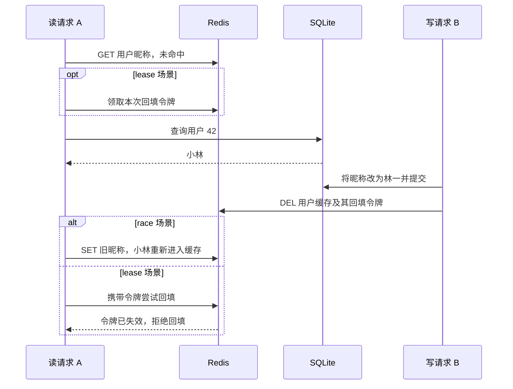

# 数据库提交了，Redis 为什么还能查到旧昵称？

用户 42 把昵称从“小林”改成“林一”。这个 demo 用 SQLite 保存用户资料，用真实 Redis 缓存昵称。每个场景执行同一次改名，并打印数据库值、缓存值和读请求的结果。可以直接观察哪一步产生了旧数据，以及后续请求怎样恢复。

## 运行

在项目根目录执行。需要 Python 3.9+、`uv` 和 `make`。macOS 或 Linux 上，如果 `redis-server` 已加入 PATH，脚本会自动启动一个临时 Redis，只监听本次运行的 Unix socket。SQLite 随 Python 提供，`redis-py` 使用项目现有的锁定依赖。

```bash
make -C demo-cache-consistency
```

默认运行全部四个场景。想看同一时序下的两种结果，可以单独运行这两条命令。

```bash
make -C demo-cache-consistency SCENARIO=race
make -C demo-cache-consistency SCENARIO=lease
```

也可以直接用 Python 入口，最后一个参数可选 `normal`、`outbox`、`race`、`lease` 或 `all`。

```bash
uv run --locked python demo-cache-consistency/demo.py outbox
```

## 四个场景会看到什么

| 场景 | 操作 | 可观察的结果 |
| --- | --- | --- |
| `normal` | 第一次读未命中，从 SQLite 回填。第二次命中。随后提交改名并删除缓存 | 刚删除时 SQLite 为“林一”，Redis 为空。下一次读回填“林一” |
| `outbox` | 在同一事务里改名并记录失效任务，模拟提交后退出、漏删缓存 | SQLite 为“林一”，Redis 仍为“小林”。恢复任务补删后在确认前中断，重试同一任务时 `DEL` 依次返回 1、0，确认后待办清空。再次查询得到“林一” |
| `race` | A 未命中并读到“小林”。B 提交改名并删缓存。A 最后才把“小林”写进 Redis | B 的删除已成功，之后发起的请求 C 仍命中“小林”。这次回填的 60 秒 TTL 从 A 写入时算起 |
| `lease` | 沿用 `race` 的顺序。A 在查库前领取回填令牌，B 删缓存时一并撤销它 | Redis 拒绝 A 的过时回填。A 自己仍返回已读到的“小林”，之后的 C 未命中，重新查库得到“林一” |

对比最后一次查询的实际输出即可看出差别。

```text
[race] 慢请求回填旧值
  C 查询后 | SQLite = 林一 | Redis = 小林

[lease] 撤销令牌阻止旧值回填
  C 查询后 | SQLite = 林一 | Redis = 林一
```

## 跟着一次旧值回填看代码



读写使用同一个 Python 进程，每次数据库操作打开独立连接。`slow_refill` 通过回调把 B 安排在 A 的数据库查询和缓存回填之间，两种场景都能稳定复现这个交错顺序。Outbox 场景同样在明确的位置模拟中断，重新打开数据库连接即可看到已经提交的待办。

用到的 Redis 操作包括 `GET`、`SET ... EX` 和 `DEL`。在 `lease` 场景中，`SET ... NX EX` 给一次回填发放有期限的唯一令牌。一条 `DEL` 同时删除数据键和令牌键，Lua 脚本将校验令牌、写值和消费令牌放进同一个 Redis 原子操作。数据库提交到执行 `DEL` 之间仍有时间窗口，需要立即看到提交结果的业务可以直接读取权威数据库。

## 关键文件

| 文件 | 内容 |
| --- | --- |
| [demo.py](./demo.py) | `UserStore.read` 实现旁路读取与回填。`deliver_one` 处理已提交的失效任务。`slow_refill` 安排 A、B、C 的执行顺序 |
| [local_redis.py](./local_redis.py) | 启动和回收本次运行的 Redis，或连接 `REDIS_URL` 指定的实例 |
| [Makefile](./Makefile) | 使用仓库已有的 Python 依赖启动指定场景 |

相关学习记录里还讨论了读自己的写入，以及权限校验、扣库存等需要更强保证的操作。[数据库与 Redis 缓存一致性](../summarize/2026-11-18-144735-数据库与Redis缓存一致性.md)

## 清理与常见问题

- **本机只有 Docker，怎样启动？** 可以先启动仓库已有的 Redis，然后显式指定连接地址。已有可用的 Redis 时，只需执行第二条命令。

  ```bash
  docker compose -f demo-install-redis/docker-compose.yml up -d redis
  REDIS_URL=redis://127.0.0.1:6379/0 make -C demo-cache-consistency
  ```

- **运行后怎样清理？** 脚本退出时会回收临时 SQLite 文件和自行启动的 Redis。使用外部实例时，每个场景只清理带本次唯一前缀的数据键和令牌键。若专为本次演示启动了仓库的 Docker 服务，可以停止它。

  ```bash
  docker compose -f demo-install-redis/docker-compose.yml stop redis
  ```

- **为什么 `race` 场景的 `DEL` 返回 0？** B 删除时，A 还没回填，缓存键原本就不存在。返回值是实际删掉的键数。在 `lease` 场景，同一时刻令牌键存在，所以 B 删掉了一个键。
