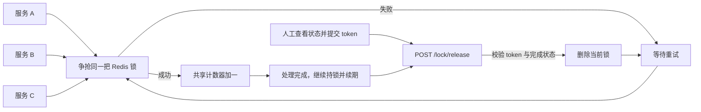

# 服务 A、B、C 争抢 Redis 锁，通过接口人工释放

## Demo 目的

用三个独立 Python 进程模拟服务 A、B、C。三个服务争抢同一把 Redis 锁，成功者操作共享资源，处理完成后继续持锁，必须由人调用 HTTP 接口释放，其他等待服务才能接棒。

默认行为：

1. 三个服务一起竞争，一个服务获得锁，其他服务持续等待。
2. 持有者读取共享计数器，模拟处理，再把值加一写回。
3. 持有者继续校验 token 并续期，等待人工释放；资源不会继续递增。
4. 人工查看状态，复制本次 token，再调用释放接口。
5. 释放后，下一个等待服务获得锁，重复上述过程。
6. 三个服务都完成并人工释放后，接口仍保持运行，便于查看最终结果。



## 涉及的 Redis 知识点

- `SET key token NX EX seconds`：原子加锁与设置租约。
- 唯一 token：区分不同服务、不同次加锁。
- Lua 续期：仅为仍属于本次 token 的锁执行 `PEXPIRE`。
- Lua 人工释放：原子检查所有权、业务完成状态，再删除锁并记录释放结果。
- 共享资源与临界区：锁 Key 保存资格，资源 Key 保存业务数据。
- TTL 兜底：持有者异常退出并停止续期后，锁自然过期。

共享资源是一个初始值为 `0` 的 Redis String，使用 `GET → 模拟处理 → SET` 展示需要锁保护的多步业务。统计用的 `INCR`、`HINCRBY` 只用于观察结果。

手动模式在模拟处理期间和等待人工释放期间都会续期。续期依赖进程正常运行及 Redis 可用；进程长时间暂停、网络中断等故障仍可能导致租约丢失。这个学习示例不代替业务幂等、数据库约束或 fencing token。

## 目录或关键文件说明

| 文件 | 说明 |
| --- | --- |
| `distributed_lock.py` | 启动服务 A/B/C、竞争锁、操作资源和续期 |
| `manual_release_api.py` | 状态接口、人工释放接口、Lua 原子校验与状态快照 |
| `test_manual_release.py` | 使用真实 Redis 和 HTTP 验证续期、人工交接、并发释放与异常退出 |
| `Makefile` | 同步依赖、检查或启动 Redis、运行 Demo 与测试 |
| `../demo-install-redis/docker-compose.yml` | 复用的 Redis 配置 |
| `../pyproject.toml`、`../uv.lock` | `redis-py`、FastAPI、Uvicorn 等现有依赖 |

## 运行前置条件

- Python 3.9 或更高版本、`uv`；使用 Makefile 时还需要 `make`。
- 已有 Redis，或安装了 Docker 与 Docker Compose。
- 默认 HTTP 端口 `8010` 可用。
- 使用浏览器的 Swagger 页面，或使用 `curl` 调用接口。

以下命令均在项目根目录执行。

## 启动或运行方式

### 终端一：启动人工释放 Demo

```bash
make -C demo-redis-lock
```

Makefile 会同步依赖，检查 `REDIS_URL`；Redis 不可用时启动仓库自带的 Redis，然后启动三个服务进程和 HTTP 接口。

已有 Redis 时也可以直接运行：

```bash
uv run python demo-redis-lock/distributed_lock.py
```

接口默认仅监听 `127.0.0.1:8010`，用于本地学习：

- Swagger 接口文档：<http://127.0.0.1:8010/docs>
- 当前状态：<http://127.0.0.1:8010/status>
- 健康检查：<http://127.0.0.1:8010/health>

### 终端二：查看当前锁状态

```bash
curl -s http://127.0.0.1:8010/status | python3 -m json.tool
```

例如，响应中的部分字段如下：

```json
{
  "lock": {
    "held": true,
    "owner": "服务A",
    "token": "服务A-<本次UUID>",
    "ttl_ms": 29800,
    "release_ready": true
  },
  "shared_resource": {
    "value": 1,
    "expected_value": 1
  },
  "active_operations": 0,
  "stats": {
    "acquired": 1,
    "manual_released": 0
  },
  "finished": false
}
```

`release_ready=true` 表示业务处理已经完成，现在允许人工释放。`active_operations=0` 只代表没有正在执行资源操作，锁仍然由 `lock.owner` 持有。

此时等待超过默认的 30 秒租约，正常续期下持有者仍不会改变，共享计数器也仍然是 `1`。

### 人工释放当前锁

从最新的 `/status` 响应复制真实的 `lock.token`，替换下面的 `<当前token>`：

```bash
curl -X POST http://127.0.0.1:8010/lock/release \
  -H 'Content-Type: application/json' \
  -d '{"token":"<当前token>"}'
```

成功响应：

```json
{
  "released": true,
  "service": "服务A",
  "token": "服务A-<本次UUID>"
}
```

随后重新查看 `/status`，就会看到下一个服务竞争成功、资源更新为 `2`，并再次等待人工释放。每次都要复制新的 token；旧 token 无法释放新持有者的锁。

也可以全程在 Swagger 页面操作：先执行 `GET /status`，复制 token，再执行 `POST /lock/release`。

## 接口说明

| 接口 | 作用 |
| --- | --- |
| `GET /health` | 检查 HTTP 服务与 Redis 连接 |
| `GET /status` | 查看当前持有者、token、剩余 TTL、共享资源、统计和各服务状态 |
| `POST /lock/release` | 提交 JSON `{"token":"..."}`，释放该 token 对应的锁 |

释放接口的返回规则：

| HTTP 状态码 | 含义 |
| --- | --- |
| `200` | 本次人工释放成功 |
| `404` | 当前没有锁，无需释放 |
| `409` | token 不匹配、锁已变更，或服务仍在处理资源 |
| `422` | 请求体缺少 token，或字段格式不正确 |
| `503` | Redis 暂不可用 |

接口不允许在业务仍处于 `processing` 阶段时释放锁。所有权和 `awaiting_release` 状态的检查与删除，在同一个 Lua 脚本内完成，避免先检查、再删除之间误删新锁。

各服务常见状态：`waiting` 等待锁、`processing` 处理资源、`awaiting_release` 等待人工释放、`released` 已释放。异常情况会显示 `lock_lost`、`failed` 等状态。

## 参数与对照实验

| 参数 | 默认值 | 含义 |
| --- | ---: | --- |
| `--services` / `--workers` | `3` | 服务实例数，前 26 个使用服务 A 至 Z，之后使用数字名称 |
| `--hold-seconds` | `1` | 读取资源后模拟业务处理的秒数 |
| `--wait-timeout` | 持续等待 | 首次竞争失败后的最长等待秒数；`0` 表示失败后跳过 |
| `--lock-ttl` | `30` | 租约秒数；手动模式持续续期，进程退出后停止续期 |
| `--api-host` | `127.0.0.1` | HTTP 监听地址 |
| `--api-port` | `8010` | HTTP 端口 |
| `--auto-release` | 不启用 | 对照模式：业务结束自动解锁，不续期、不启动 HTTP 接口 |
| `--redis-url` | `REDIS_URL` 或 `redis://localhost:6379/0` | Redis 连接地址 |

端口被占用时：

```bash
make -C demo-redis-lock run ARGS="--api-port 8011"
```

连接其他 Redis：

```bash
make -C demo-redis-lock run START_REDIS=0 REDIS_URL=redis://localhost:6380/0
```

恢复自动释放、每个服务只抢一次的对照例子：

```bash
make -C demo-redis-lock run ARGS="--auto-release --wait-timeout 0"
```

自动释放、等待重试：

```bash
make -C demo-redis-lock run ARGS="--auto-release --wait-timeout 10"
```

演示不续期时 TTL 过短导致的并发覆盖：

```bash
uv run python demo-redis-lock/distributed_lock.py \
  --auto-release --services 3 --hold-seconds 4 --wait-timeout 12 --lock-ttl 1
```

## 预期输出或可观察现象

默认运行时可能看到：

```text
服务A 抢锁成功，开始操作共享资源（当前并发数=1）
服务B 首次抢锁失败，等待其他服务释放锁（直到人工释放）
服务C 首次抢锁失败，等待其他服务释放锁（直到人工释放）
服务A 完成共享资源更新：0 -> 1
服务A 继续持锁并续期，等待人工调用 POST /lock/release
```

调用释放接口后：

```text
人工通过接口释放了 服务A 的锁，其他等待服务可以继续竞争
服务B 抢锁成功，开始操作共享资源（当前并发数=1）
服务B 完成共享资源更新：1 -> 2
服务B 继续持锁并续期，等待人工调用 POST /lock/release
```

实际服务顺序不固定。完成三次操作、三次人工释放后，`finished=true`、`lock.held=false`，共享资源实际值和预期值都为 `3`，`manual_released=3`，`overlap=0`。

## 验证方式

Redis 已启动后运行：

```bash
make -C demo-redis-lock test
```

测试使用空闲端口和独立运行标识，验证以下行为，结束后只清理自己生成的数据：

- 处理中拒绝提前释放；缺少或错误 token 不会删除锁。
- 超过短租约时间仍保持同一持有者，证明续期有效。
- 并发释放相同 token 只有一次成功，旧 token 不会释放新持有者的锁。
- 三个服务通过人工接口依次交接，共享资源从 `0` 更新到 `3`。
- 进程停止后不再续期，锁最终自然过期。

## 清理方式

在启动 Demo 的终端按 `Ctrl+C`，HTTP 服务和子进程会停止。停止时不会代替人工主动删除仍持有的锁；续期停止后，锁最多再存活一个租约周期。业务处理完成后应优先通过接口释放。

接口运行期间保留演示数据，退出后共享资源、统计和各服务状态约 5 分钟后自动过期。每次运行使用独立 Key，重启不会复用旧锁。

如果需要在退出后立即清理，从 `/status` 或日志取得本次运行标识，只删除本次运行的数据：

```bash
redis-cli DEL \
  'demo:redis-lock:<运行标识>:lock' \
  'demo:redis-lock:<运行标识>:active' \
  'demo:redis-lock:<运行标识>:result' \
  'demo:redis-lock:<运行标识>:resource' \
  'demo:redis-lock:<运行标识>:service:服务A' \
  'demo:redis-lock:<运行标识>:service:服务B' \
  'demo:redis-lock:<运行标识>:service:服务C'
```

使用更多服务时，还要清理对应的服务状态 Key；也可以直接等待过期。

停止仓库启动的 Redis 并保留数据卷：

```bash
make -C demo-redis-lock redis-stop
```

## 常见问题

- **释放返回 409**：重新查询 `/status`，确认 `release_ready=true`，并使用最新 token。
- **共享资源已经变成 1，另外两个服务还在等待**：这是人工释放模式的预期行为，需要调用接口释放当前锁。
- **为什么还有 TTL**：持续续期让正常流程等待人工操作，TTL 则在持有进程异常退出后兜底，避免永久锁。
- **三次释放后程序为什么没退出**：HTTP 接口保留用于查看最终结果，按 `Ctrl+C` 结束。
- **连接 Redis 失败**：执行 `docker compose -f demo-install-redis/docker-compose.yml up -d redis`，或设置正确的 `REDIS_URL`。

## 参考

- [Redis 官方分布式锁说明](https://redis.io/docs/latest/develop/clients/patterns/distributed-locks/)：锁所有权、续期及故障边界。
- [FastAPI 请求体](https://fastapi.tiangolo.com/tutorial/body/)：释放接口的 JSON 参数与文档。
