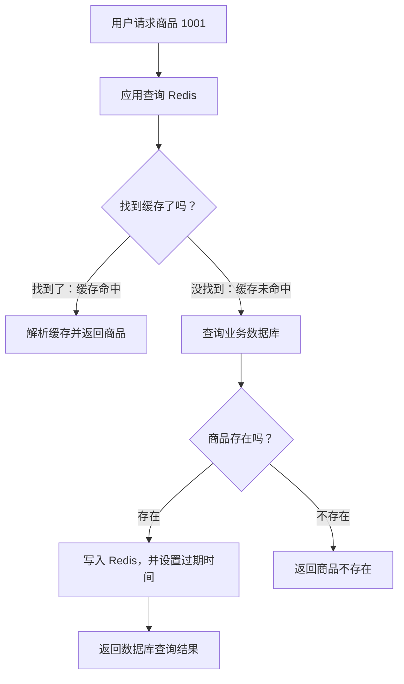

记录时间：2026-10-19 17:35:43 (Asia/Shanghai)

**从零认识 Redis：让应用快速访问数据的内存数据库**

想象你正在做一个电商网站。用户打开商品详情页，要看到商品名称、图片和价格。最初，应用每次都去数据库查询，功能完全正常；当同一件热门商品被反复访问，数据库就开始重复处理大量相似的请求。

Redis 经常出现在这个时候。它可以保存一份便于快速读取的商品信息，让许多请求直接取得结果，减少对数据库的重复访问。

我们就用“商品详情缓存”这个例子，认识 Redis 的基本概念、常用命令和使用边界。

**一、为什么页面会变慢？先看看一次查询经历了什么**

用户点击商品后，请求先到应用服务，应用再访问数据库，最后把结果返回给用户。

一次数据库查询可能涉及连接等待、SQL 执行、索引查找和数据读取。数据库本身也会使用内存缓存，因此不能简单地认为“每次查询都要读磁盘”。不过，即使数据已经在数据库的内存中，反复执行查询、传输结果，也需要资源。

假设商品 1001 的名称和介绍在短时间内没有变化，却有许多用户不断打开它的详情页。应用每次都重新查询，会做不少重复工作。

这时可以增加一层缓存：第一次查到商品后，把结果放进 Redis；后续请求先去 Redis 找，找到就直接返回。

就像店员把常被问到的商品资料放在手边，顾客再问时，可以直接拿出来。缓存的价值在于复用已经取得的数据。

**二、Redis 是什么？从一组 Key 和 Value 开始**

Redis 是一个以内存存储为核心、支持多种数据结构的数据库。本文讨论的是把数据主要放在内存中的常见使用方式。

它通过 Key 找到 Value。可以先把它理解为“用一个名字，找到一份数据”。

例如，我们给商品 1001 的详情缓存取一个名字：

```text
learn:redis:product:1001
```

这个名字就是 Key。它对应的 Value，可以是一段 JSON：

```json
{"id":1001,"name":"keyboard","price_cents":29900}
```

这里的商品是一把机械键盘，价格为 299 元。`price_cents` 使用“分”作为单位，所以保存的是整数 `29900`。

`learn:redis:` 是本文练习使用的前缀；`product` 表示商品；`1001` 是商品编号。冒号只是方便人阅读的命名习惯，不会自动创建文件夹或层级。

Redis 的用途也不局限于缓存。访问计数、排行榜、去重，都可以利用它提供的数据结构完成。[Redis 官方数据类型概览](https://redis.io/docs/latest/develop/data-types/)

在我们的案例里，两种存储承担不同职责：业务数据库保存商品的正式记录，Redis 保存可以重新生成的商品副本。以后说“查数据库”，指的就是这个业务数据库。

**三、为什么 Redis 通常能很快返回数据？**

首先，常用读写主要在内存中完成。访问内存通常比访问磁盘具有更低的延迟。

其次，Redis 为不同操作提供了合适的数据结构。查找一个 Key、增加一个计数、读取排行榜，都有对应的处理方式。

此外，它使用高效的网络事件处理机制，可以处理许多客户端连接。

这些因素共同帮助 Redis 实现较低延迟。不过，请求还要经过网络，命令也要消耗计算资源。Value 很大、一次处理很多元素，或者网络拥堵时，响应都会受到影响。不能因为用了 Redis，就承诺所有操作都很快。[Redis 官方延迟说明](https://redis.io/docs/latest/operate/oss_and_stack/management/optimization/latency/)

对商品详情页而言，真正需要观察的是：加了缓存之后，接口响应时间有没有改善，数据库查询量有没有减少。性能收益要通过实际业务数据验证。

**四、认识五种常用数据类型**

Redis 的 Value 可以有不同的组织方式。下面这五种类型，适合用来建立最初的认识：

| 类型 | 可以怎样理解 | 商品业务中的例子 | 常见命令 |
|---|---|---|---|
| String | 保存一个值，也可以保存整数或序列化后的内容 | 商品详情 JSON、浏览次数 | `SET`、`GET`、`INCR` |
| Hash | 一个 Key 下保存多个字段和值 | 分别保存商品名称、价格等字段 | `HSET`、`HGET` |
| List | 有顺序、允许重复的元素列表 | 保存最近浏览过的商品编号 | `LPUSH`、`LRANGE` |
| Set | 成员不重复的集合 | 保存商品标签、计算共同标签 | `SADD`、`SMEMBERS` |
| Sorted Set | 成员不重复，每个成员关联一个分数 | 按热度给商品排行 | `ZADD`、`ZRANGE` |

Sorted Set 中，不同成员可以具有相同分数。这些是常用类型，Redis 还提供其他类型。[Redis 官方数据类型概览](https://redis.io/docs/latest/develop/data-types/)

我们把商品转成 JSON，再通过 `SET` 保存，使用的仍然是 String。普通 `GET` 取回的是整段内容；应用需要解析 JSON，才能得到里面的商品名称和价格。

如果经常需要单独读取或修改商品的某个字段，可以考虑 Hash。例如：

```text
HSET learn:redis:product:1002:fields name keyboard price_cents 29900
HGET learn:redis:product:1002:fields price_cents
```

第二条命令会返回字段值 `29900`。本文后续统一使用 String 保存整份商品详情，便于理解缓存的完整流程。

**五、用几个命令，亲手保存一份商品缓存**

下面假设你已经启动了本地 Redis，并安装了 `redis-cli`。示例使用本地 `127.0.0.1:6379`；所有结果都是预期现象，具体显示格式可能随客户端设置变化。

先在终端连接：

```bash
redis-cli -h 127.0.0.1 -p 6379
```

连接后，下面的 Redis 命令在 `redis-cli` 中执行。

**先写入，再读取**

```text
SET learn:redis:product:1001 '{"id":1001,"name":"keyboard","price_cents":29900}'
GET learn:redis:product:1001
```

`SET` 成功时返回 `OK`；`GET` 返回刚才保存的 JSON 字符串。

此时，应用已经可以通过商品编号对应的 Key，取得一份商品资料。

**给数据设置一个期限**

商品资料可能变化，缓存也不能无限占用内存。可以先给刚才的 Key 设置 10 秒过期时间：

```text
EXPIRE learn:redis:product:1001 10
TTL learn:redis:product:1001
```

如果 Key 仍然存在，`EXPIRE` 成功返回整数 `1`。`TTL` 用来查看剩余的存活时间，单位是秒；刚设置完时，可能看到 `10`，也可能已经变成 `9`。

等待超过 10 秒，再执行：

```text
GET learn:redis:product:1001
TTL learn:redis:product:1001
```

如果期间没有其他操作重新写入，`GET` 会返回空结果，默认 `redis-cli` 通常显示为 `(nil)`；`TTL` 返回 `-2`，表示 Key 不存在。

`TTL` 的三个常见结果要记清：非负整数表示剩余秒数；`-1` 表示 Key 存在但没有过期时间；`-2` 表示 Key 不存在。没有过期时间，也不代表数据绝不会被删除或淘汰。[TTL 官方说明](https://redis.io/docs/latest/commands/ttl/)

**业务中，通常把写入和设置期限放在一起**

对于本文的商品缓存，可以这样写：

```text
SET learn:redis:product:1001 '{"id":1001,"name":"keyboard","price_cents":29900}' EX 300
```

`EX 300` 表示在同一条命令中写入数据，并设置 300 秒后过期。

如果分成 `SET` 和 `EXPIRE` 两条命令，中间发生异常，就可能只完成写入，没有设置期限。`SET ... EX ...` 可以避免这个间隙。

还有一个容易忽略的细节：普通 `SET` 覆盖已有值时，默认会清除原来的过期时间。因此，重写这类缓存时，要同时重新设置期限；需要保留原期限时，也有相应选项。[SET 官方说明](https://redis.io/docs/latest/commands/set/)

这里的 300 秒只是教学示例。实际期限需要根据数据变化频率、业务能接受多久的旧数据，以及数据库承载能力来选择。

**判断是否存在，以及主动删除**

```text
EXISTS learn:redis:product:1001
DEL learn:redis:product:1001
EXISTS learn:redis:product:1001
```

在 Key 未过期且没有其他操作干扰的情况下，三条命令依次返回 `1`、`1`、`0`：先确认存在，再删除一个 Key，最后确认已经不存在。

**用 INCR 记录浏览次数**

浏览次数适合单独放在一个 Key 中：

```text
INCR learn:redis:product:1001:views
INCR learn:redis:product:1001:views
```

如果这个计数 Key 原本不存在，两次执行会依次返回 `1` 和 `2`。

`INCR` 在 Redis 内部完成加一，这条命令具有原子性。多个客户端同时执行时，不会像应用先 `GET`、自己加一、再 `SET` 那样，因互相覆盖而丢掉某次递增。它要求值能表示为规定范围内的整数，不能对前面的商品 JSON 直接执行。[INCR 官方说明](https://redis.io/docs/latest/commands/incr/)

**六、把 Redis 接进商品详情查询**

掌握命令后，还需要解决一个问题：应用什么时候读 Redis，什么时候查数据库？

一种常见方式叫 Cache-Aside，通常译为旁路缓存。由应用协调两边，流程如下：



**缓存命中**，就是找到了可用的缓存数据；**缓存未命中**，就是需要到数据库重新查询。缓存未命中是正常情况，不能直接理解为商品不存在。

第一次访问时，Redis 里可能没有商品 1001。应用查数据库，取得商品，再写入 Redis。后续访问如果命中，就直接使用这份缓存。缓存过期或被淘汰后，应用再从数据库加载。

这些步骤由应用完成。Redis 不会根据商品编号自动查数据库，也不会自动发现商品已经改价。[Redis 官方 Cache-Aside 说明](https://redis.io/docs/latest/develop/use-cases/cache-aside/)

**商品改价后，旧缓存怎么办？**

假设商品从 299 元改为 279 元，数据库已经更新，Redis 中却还存着旧价格。继续使用缓存的用户，就可能看到 299 元。

一种常见做法是：先成功更新数据库，再删除对应的商品缓存。下一次读取未命中时，应用会重新加载商品资料。

这个做法仍有局限：删除缓存可能失败；并发请求也可能先读到旧商品，等更新和删除完成后，又把旧数据写回缓存。因此，它不能保证缓存与数据库时时一致。需要结合重试、同步机制和业务要求处理；过期时间可以帮助旧缓存最终失效。[Redis 官方缓存一致性讨论](https://redis.io/blog/cache-consistency-strategies/)

对于商品详情展示，可以按业务要求接受一定的旧数据窗口；进入下单、结算等环节时，应由相应业务流程校验有效价格和库存。

**七、数据放在内存里，重启后怎么办？**

内存里的数据会受到进程退出、机器重启等情况影响。Redis 提供持久化机制，把数据或写操作记录保存到磁盘，帮助重启后恢复。

常见的两种方式是 RDB 和 AOF：

| 方式 | 通俗理解 | 需要关注什么 |
|---|---|---|
| RDB | 给某一时刻的数据拍一张快照 | 快照之后、尚未保存的修改可能丢失 |
| AOF | 记录写操作，恢复时据此重建数据 | 数据丢失风险、磁盘开销和恢复过程受配置影响 |

两种方式可以结合使用。开启持久化也不能直接承诺绝不丢数据，需要结合配置和故障情况判断。[Redis 官方持久化说明](https://redis.io/docs/latest/operate/oss_and_stack/management/persistence/)

再把三个概念放在一起看：

| 概念 | 主要回答的问题 | 商品缓存中的含义 |
|---|---|---|
| 过期 | 这份数据保存多久？ | 写入时指定 300 秒有效期 |
| 内存淘汰 | 达到内存限制后，怎样腾出空间？ | 按配置选择一些缓存删除 |
| 持久化 | 重启后怎样恢复数据？ | 从磁盘记录恢复 Redis 数据 |

过期不要求在到点的那一瞬间立即释放所有相关内存。Redis 结合访问时检查和主动检查处理过期 Key；正常读取不会因为清理尚未完成，就继续返回已经过期的值。[EXPIRE 官方说明](https://redis.io/docs/latest/commands/expire/)

内存淘汰则由 `maxmemory`、`maxmemory-policy` 等配置控制。尚未过期的缓存，也可能因淘汰而消失。如果使用 `noeviction`，达到限制时，某些需要增加内存的写入会报错。[Redis 官方淘汰策略说明](https://redis.io/docs/latest/develop/reference/eviction/)

对商品详情缓存来说，应用必须能处理“刚才还在，现在没有”的情况。商品正式记录仍在数据库里，缓存丢失时可以重新生成。

**八、第一次使用 Redis，哪些地方容易出问题？**

**缓存内容太多，或者迟迟不失效。** 把所有商品、所有图片和所有评论塞进一个 Key，会增加传输和处理负担；不断加入数据却不考虑期限和容量，也可能让内存持续增长。本文只缓存一件商品的必要展示字段，图片可以保存地址。

**把单条命令的原子性，扩大到整个业务流程。** `INCR` 可以原子递增，但“查库存、判断是否足够、再扣减”是多个步骤；“更新数据库、删除 Redis 缓存”还跨越了两个系统。它们都需要额外的并发或一致性设计。

**认为缓存不可用时，直接把所有请求送给数据库就行。** 少量请求可以回源；高并发时，数据库未必接得住。上线前需要考虑超时、限制回源并发、限流和降级方式。

还有三个常见术语，可以继续用商品例子区分：

| 问题 | 商品详情页中的现象 | 常见处理思路 |
|---|---|---|
| 缓存穿透 | 不断查询不存在的商品，缓存和数据库都查不到，请求反复到达数据库 | 参数校验；短期缓存“商品不存在”的结果 |
| 缓存击穿 | 一个热门商品的缓存失效，大量请求同时回源查询它 | 让同一商品的并发请求共享一次回源结果 |
| 缓存雪崩 | 大量商品缓存集中失效，或缓存服务不可用，大量请求同时回源 | 分散过期时间，结合容量、限流和降级设计 |

这是常见的工程分类。热门缓存失效引起的并发回源，也常被称为 cache stampede 或 thundering herd。[Redis 官方并发回源讨论](https://redis.io/blog/how-to-tame-the-thundering-herd-problem/)

如果缓存“商品不存在”的结果，要设置较短期限，并考虑新增商品时使这类缓存失效，否则刚创建的商品可能暂时仍显示不存在。这类空结果与“完全没有缓存”也要用不同的表示区分开。[Redis 官方缺失记录处理建议](https://redis.io/docs/latest/develop/use-cases/cache-aside/redis-py/)

这些措施各自针对不同问题，不能只靠一个过期时间解决全部情况。

**九、把全文串起来：一份商品详情缓存怎样工作**

现在给商品 1001 定一套教学用的约定：

- 业务数据库保存正式商品资料。
- Redis Key 为 `learn:redis:product:1001`。
- Value 使用 String，保存商品详情 JSON。
- 示例过期时间为 300 秒。
- 商品更新成功后，应用删除对应缓存。

下面用接近 Python 的伪代码表达读取主线。它省略了客户端初始化、连接超时、异常处理和并发控制，用于理解步骤：

```python
def get_product(product_id):
    key = f"learn:redis:product:{product_id}"

    cached = redis.get(key)
    if cached is not None:
        return json.loads(cached)

    product = database.find_product(product_id)
    if product is None:
        return None

    redis.set(key, json.dumps(product), ex=300)
    return product
```

这里用 `is not None` 判断缓存是否存在，避免把“没有值”和其他可能的值混淆。本例查不到商品时直接返回，尚未加入上一节提到的空结果缓存。

把几个时刻连起来，就能看到它的行为：

第一次打开商品详情，应用没有命中缓存，于是查数据库，把 299 元的商品资料写入 Redis，并返回给用户。

第二位用户在缓存有效时打开同一商品，应用从 Redis 得到资料，省去这次数据库查询。

缓存过期后，再有用户访问，应用重新查数据库并生成缓存。若此时许多用户同时访问，就需要考虑前面提到的并发回源问题。

商家把商品改为 279 元时，更新主线可以写成：

```python
def update_product(product_id, changes):
    # 这一步代表数据库更新已经成功提交
    database.update_product_and_commit(product_id, changes)

    key = f"learn:redis:product:{product_id}"
    redis.delete(key)
```

理想情况下，下次读取会重新加载 279 元的商品资料。前面提到的删除失败、并发写回旧数据等情况，仍需要在实际实现中处理。

练习结束后，可以在 `redis-cli` 中删除本文使用的几个 Key：

```text
DEL learn:redis:product:1001 learn:redis:product:1001:views learn:redis:product:1002:fields
```

再次执行 `GET learn:redis:product:1001` 会得到空结果。如果此时从应用访问商品详情，而应用已经实现上述加载逻辑，就会查到数据库里的商品，并重新生成缓存。这个可观察的过程，正好展示了缓存怎样参与一次真实的业务查询。
