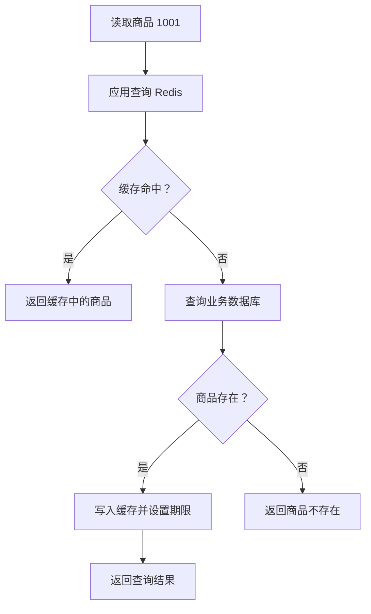

记录时间：2026-10-19 17:45:16 (Asia/Shanghai)

**第10章｜Cache-Aside：商品详情的缓存读取流程**

**本章解决什么问题**

应用什么时候查 Redis，什么时候查业务数据库？

**由应用协调两边**

Cache-Aside 通常译为旁路缓存。读取商品时，应用先查缓存；没有命中，就查数据库；商品存在时，把结果写回缓存并设置期限，再返回给用户。



缓存未命中只表示没有取得缓存，不能据此判断商品不存在。

**一个简化例子**

下面是接近 Python 的伪代码，用来表示读取主线：

```python
def get_product(product_id):
    key = f"learn:redis:product:{product_id}"
    cached = redis.get(key)
    if cached is not None:
        return json.loads(cached)

    product = database.find_product(product_id)
    if product is None:
        return None

    redis.set(key, json.dumps(product), ex=300)
    return product
```

**可以观察到什么**

第一次访问通常需要查数据库；有效缓存生成后，再次访问可能直接命中；缓存失效后，再访问会重新加载。

**一点注意**

示例省略了客户端初始化、超时、异常和并发控制。缓存不可用时，直接让全部请求回源可能压垮数据库。商品更新后的缓存处理另见缓存一致性章节。

参考：[Redis Cache-Aside](https://redis.io/docs/latest/develop/use-cases/cache-aside/)

返回：[分章目录](./2026-10-19-174516-Redis入门目录.md) · [Notion 本章](https://app.notion.com/p/3fef19459cb281d69561fe84b6fc3d63?pvs=204)

来源：由[原始 Redis 入门记录](../2026-10-19-173543-Redis入门文章/2026-10-19-173543-Redis入门.md)拆分整理。
