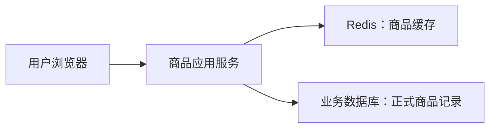

记录时间：2026-10-19 17:51:39 (Asia/Shanghai)

**第01章｜认识 Redis：为什么商品详情需要缓存**

**从一个商品详情页说起**

你打开一家电商网站，点击商品 1001，页面显示机械键盘的名称、介绍和 299 元的价格。看起来只是展示几个字段，背后却可能经历一串工作：应用接收请求、取得数据库连接、执行查询、整理结果，再通过网络返回给浏览器。

如果一天只有几个人访问，这套流程通常够用。但促销开始后，同一件商品可能被反复查看，而商品介绍在这段时间里几乎没有变化。应用却一次又一次查到相同资料。这里出现了一个值得优化的地方：已经取得的结果，能不能让后面的请求继续使用？

缓存就是保存一份方便重复读取的数据。Redis 经常承担这份工作的存储服务。本章先弄清它在系统中的位置，具体的数据类型和缓存读取算法放在各自章节展开。

**Redis 是什么，为什么叫键值数据库**

Redis 是一个支持多种数据结构的数据库。在本文讨论的常见部署中，它主要从内存提供数据访问，同时也可以通过持久化机制把相关数据保存到磁盘。内存访问帮助它实现较低延迟，但内存容量、故障恢复和数据有效性仍然需要认真设计。[Redis FAQ](https://redis.io/docs/latest/develop/get-started/faq/)

最基本的使用方式，是用 Key 找到 Value。Key 像资料上的编号，Value 是编号对应的内容。商品 1001 可以使用下面的 Key：

```text
learn:redis:product:1001
```

对应内容是一段 JSON：

```json
{"id":1001,"name":"keyboard","price_cents":29900}
```

`price_cents` 以分为单位，`29900` 表示 299 元。对 Redis 的普通 String 操作来说，这是一段字符串；应用解析后，才得到商品编号、名称和价格。Redis 不会仅凭这段内容，就自动理解你的商品表。

Key 中的冒号只是命名习惯，没有自动创建文件夹。前缀 `learn:redis:` 用于识别本文练习数据。真实项目还可以把应用、环境和业务名称放进命名约定，减少不同用途的数据互相覆盖。命名要有规律，但没有必要把整段商品介绍都写进 Key。

**它和浏览器、应用、数据库是什么关系**

Redis 通常作为独立服务运行。浏览器访问商品接口，应用服务负责业务处理，再通过 Redis 客户端库发送命令。`redis-cli` 也是客户端，只是它方便人在终端中手动操作。多台应用可以连接同一套 Redis，取得共享的数据。



图里 Redis 和数据库之间没有自动同步的箭头，这是有意的。在本文采用的缓存方案中，查缓存、查数据库、把结果放回缓存，都由应用协调。没有相应代码，单独启动 Redis 并不会让商品接口自动变快。[Cache-Aside 官方说明](https://redis.io/docs/latest/develop/use-cases/cache-aside/)

这也解释了为什么它不同于应用里的一个普通变量。普通变量随某个应用进程存在，不同进程可能各存一份；独立的 Redis 服务可以被多个进程访问。当然，独立服务也会引入网络往返、连接管理和服务可用性问题，并不是完全没有代价。

**跟着做一次最小体验**

假设你已经启动本地 Redis，并安装 `redis-cli`。先在终端连接：

```bash
redis-cli -h 127.0.0.1 -p 6379
```

随后在客户端里输入下面的命令。只操作专门的学习 Key，第一条命令让这个例子从空白状态开始。

```text
PING
DEL learn:redis:product:1001
SET learn:redis:product:1001 '{"id":1001,"name":"keyboard","price_cents":29900}'
GET learn:redis:product:1001
```

预期 `PING` 返回 `PONG`，说明服务能响应当前连接；`SET` 返回 `OK`；`GET` 取回刚才保存的 JSON。默认客户端可能在字符串周围显示引号和转义符，这属于展示格式。这组结果是预期现象，不是本文对你机器的实测记录。[redis-cli 使用说明](https://redis.io/docs/latest/develop/tools/cli/)

做完这一步，Redis 只是保存了商品资料。浏览器是否能使用它，还取决于商品接口有没有加入相应的读取逻辑。把“数据已经写进去”和“业务已经接入缓存”区分开，后面就不容易困惑。

**在商品业务里，哪份数据说了算**

本系列约定：业务数据库保存正式商品记录，Redis 保存可重新生成的副本。商家把价格从 299 元改成 279 元时，数据库中的商品更新，并不意味着缓存已经同时更新。副本可能落后于正式记录，这就是后面缓存一致性章节要处理的问题。

缓存缺失也不等于商品被删除。Redis 中没有商品 1001，可能只是从未缓存、已经过期，或因为内存限制被淘汰。应用需要按约定回到业务数据库确认。

同样，不能把“内存数据库”理解成数据绝不能保存到磁盘。Redis 提供持久化选择；也不能把“支持持久化”理解成所有故障下都不会丢数据。不同机制解决的问题和付出的成本，在 RDB、AOF 章节分别介绍。

**什么情况下值得缓存**

重复读取多、结果有复用价值、业务允许一定更新延迟的数据，通常值得评估。例如商品名称、展示介绍和某些聚合结果。若数据每次请求都完全不同，几乎不会再次访问，写入缓存反而可能增加开销。

还要考虑一次结果有多大、多久变化、需要占多少内存。把所有图片二进制、全部评论和所有商品一次塞进一个 Key，往往会让传输和更新变重。商品详情缓存可以只保存需要展示的字段，图片保存地址，分页内容另作设计。

Redis 也可以用来完成计数、集合判断和排行榜，不限于复制数据库结果。学习它时，可以先问“我的操作是什么”，再选择数据类型，而不是看到所有需求都先转成一大段 JSON。

**读完后做一个判断练习**

假设商品介绍一小时才变化一次，但库存每秒变化。它们是否适合使用完全相同的缓存策略？可以先写下你的理由：读取频率、允许延迟、数据大小和更新方式分别是什么。这里没有统一的五分钟答案，重点是把业务要求讲清楚。

练习结束后，在 `redis-cli` 中执行 `DEL learn:redis:product:1001` 清理数据。下一章会继续解释，为什么 Redis 常见访问很快，以及“命令很快”和“页面很快”之间还隔着哪些工作。


[返回目录](./2026-10-19-175139-Redis入门目录.md) · [下一章](./2026-10-19-175139-02-Redis为什么快.md) · [Notion 本章](https://app.notion.com/p/3fef19459cb281f0aabce3cae7cc83b7?pvs=204)

扩写关联：[上一版学习记录](../2026-10-19-174516-Redis入门分章/2026-10-19-174516-01-认识Redis.md)。本版补充了机制解释、案例过程、预期现象、方案取舍及练习。
