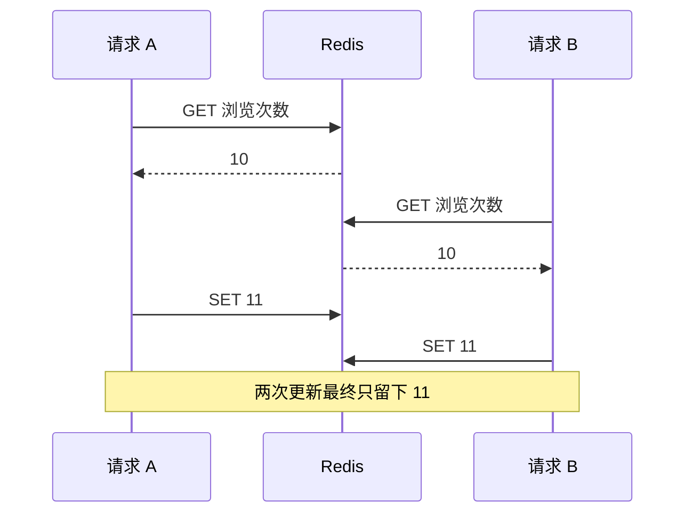

记录时间：2026-10-19 17:51:39 (Asia/Shanghai)

**第09章｜INCR 与原子性：浏览次数如何递增**

**从丢失的一次浏览开始**

商品 1001 的浏览次数目前是十。两个用户几乎同时打开详情页，应用想把次数增加到十二。最直观的程序，是先读取当前值，在应用中加一，再把结果写回去。

问题在于，两个请求可能都先读到十，各自算出十一，然后分别把十一写回。发生了两次浏览，最终只增加一次。这不是加法算错了，而是多个步骤在并发执行时交错了。



**把读取、加一和保存交给一条命令**

`INCR` 在 Redis 内部完成整数递增。其他客户端的命令不能插入这条操作的中间，看到一个只完成一半的递增。因此，在正常各执行一次且没有删除、重置等额外操作的条件下，多次递增可以累计。

这里的原子性，指这条命令执行时不可被其他客户端命令拆开穿插。它不自动保证持久化、不自动保证客户端只发送一次，也不把整个商品业务变成一个不可分割的动作。[INCR](https://redis.io/docs/latest/commands/incr/)

**从零开始跟着做**

假设本地 Redis 已启动，在终端连接 `redis-cli -h 127.0.0.1 -p 6379`。下面只重置学习计数 Key，不会删除商品详情 JSON。

```text
DEL learn:redis:product:1001:views
INCR learn:redis:product:1001:views
INCR learn:redis:product:1001:views
GET learn:redis:product:1001:views
```

如果没有其他客户端同时修改，两个 `INCR` 依次返回整数 `1`、`2`。Key 不存在时，Redis 先按零处理，再增加一。`GET` 取回表示二的字符串，客户端可能显示为 `"2"`。整数递增仍然操作 String 类型，别因为能加一，就以为它换成了另外一种数据类型。

计数与详情分开使用 Key，是为了让每个值的用途清楚。商品详情保存整段 JSON，不能直接对它执行 `INCR`，否则 Redis 无法把它解释成合法整数。

**一次增加多个，以及减少计数**

如果导入一批已经确认的浏览记录，可以用 `INCRBY` 指定增量：

```text
INCRBY learn:redis:product:1001:views 5
DECR learn:redis:product:1001:views
GET learn:redis:product:1001:views
```

接着前面的二执行，返回值依次是七、六，最后读到六。它们表达的是算术操作，Redis 不知道这个增量代表真实浏览、补偿还是误操作。业务必须先确定事件的含义，再选择加减方式。[INCRBY](https://redis.io/docs/latest/commands/incrby/)、[DECR](https://redis.io/docs/latest/commands/decr/)

尤其不能把“先查库存大于零，再执行递减”当成天然安全。检查和递减是两个步骤，其他请求可以夹在中间；单独的 `DECR` 也允许得到负数。库存扣减需要另外设计条件检查与修改的一致执行，本章不把浏览计数示例直接套成库存方案。

**值的格式和范围也有要求**

整数操作使用有符号六十四位整数的范围。已有值无法解析，或者结果超过范围时，命令会报错，而不是自动变成无限大的整数。浮点增量另有命令，也需要考虑精度和业务意义，不能随手拿浏览计数的方法处理金额计算。

可以用单独的错误示例 Key 观察格式错误：

```text
SET learn:redis:product:1001:views:invalid "many"
INCR learn:redis:product:1001:views:invalid
GET learn:redis:product:1001:views:invalid
```

预期第二条报整数格式相关错误，最后仍读到 `"many"`。报错不代表 Redis 自动把它修正为零。排查时应检查最初是谁写入了不合适的值，而不是用强制覆盖掩盖数据用途混乱。

**原子性没有消除网络的不确定性**

应用发送一次递增，Redis 可能已经执行成功，但返回包在网络中丢失或晚到。客户端看见超时，并不能据此确认命令没有执行。如果直接重试一次，就可能多加一次。

因此，原子计数保证的是单条命令在服务端的执行性质，“一条业务事件只算一次”则涉及请求标识、去重和处理流程。访问热度允许少量误差时，可以采用较简单的设计；需要精确记账时，就必须明确重复、丢失和恢复的要求。不要把“用了原子命令”当成业务准确性的全部证据。[Redis 客户端生产使用建议](https://redis.io/docs/latest/develop/clients/redis-py/produsage/)

**计数和过期放在一起时，还要问几个问题**

浏览计数可能按天保存。一个常见写法是先 `INCR`，再 `EXPIRE`。如果两条命令之间应用退出，计数可能没有期限；如果每次浏览都重新设置同一段期限，得到的又可能是不断续期的窗口，而不是固定自然日。

这些问题要求先定义统计口径：是总次数、某个日期内的次数，还是最近一段时间的活跃次数？再决定 Key 命名、到期时刻和组合操作方式。Lua 脚本、事务等机制可以帮助组织某些 Redis 内操作，但也需要理解错误、范围和部署约束，不能只补一条命令就认为设计完成。

同样，即使 Redis 内的计数与期限已经协调好，数据库更新和 Redis 递增仍然分属不同步骤。一次订单成功后怎样记录指标、失败后怎样补偿，要在业务层说明。原子命令为我们提供可靠的积木，并不替我们拼好整个系统。

**用两个终端验证你是否理解**

先把练习计数设为十。在两个客户端里依次交错执行“先各自 `GET`，再各自 `SET 11`”，就能重现丢失更新；再次重置后，让两个客户端各执行一次 `INCR`，在没有其他操作时，最终应为十二。这个练习不需要压测，重点是观察步骤能否交错。

再思考：如果一次请求超时，怎样判断是否需要重试？若业务要求精确统计，应该增加什么信息来识别同一次事件？写下这个问题，比单独背诵“Redis 命令具有原子性”更有帮助。

清理时执行 `DEL learn:redis:product:1001:views learn:redis:product:1001:views:invalid`。本章所有数字都是教学初始条件下的预期结果，真实业务还要观察事件是否重复、写入是否失败，以及数据是否能按要求恢复。


[上一章](./2026-10-19-175139-08-过期时间.md) · [返回目录](./2026-10-19-175139-Redis入门目录.md) · [下一章](./2026-10-19-175139-10-Cache-Aside旁路缓存.md) · [Notion 本章](https://app.notion.com/p/3fef19459cb281e9a845f34a7b26fc51?pvs=204)

扩写关联：[上一版学习记录](../2026-10-19-174516-Redis入门分章/2026-10-19-174516-09-INCR与原子性.md)。本版补充了机制解释、案例过程、预期现象、方案取舍及练习。
