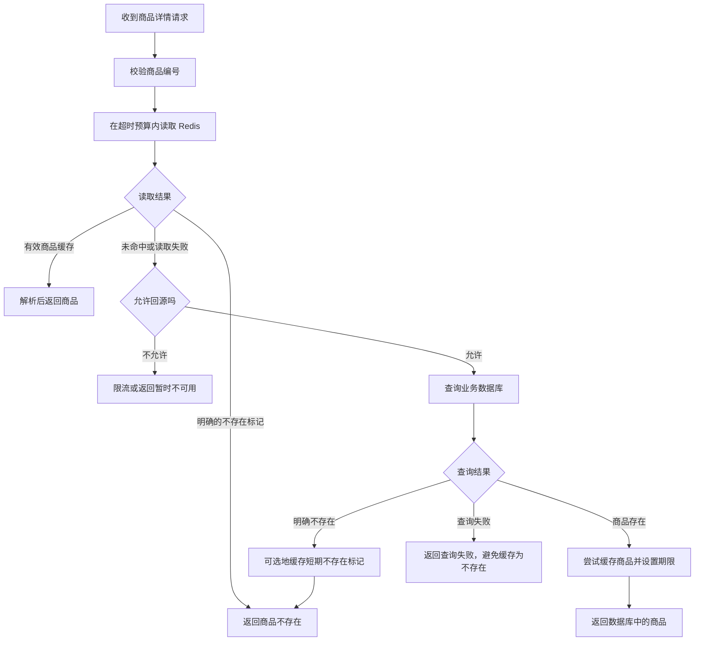

记录时间：2026-10-19 17:51:39 (Asia/Shanghai)

**第10章｜Cache-Aside：商品详情的缓存读取流程**

**从一个商品详情请求开始**

假设我们的商城有一件商品，编号是 1001，名称是机械键盘，售价 299 元。商品表里保存着它的正式资料。一天里有很多人反复打开这个页面，但商家可能只修改一两次介绍。每次访问都查询商品表，会反复取得几乎相同的结果。我们希望把查到的资料暂存在 Redis，让后来的访问复用它，同时保留从数据库重新取得资料的能力。

这正是 Cache-Aside，中文通常叫旁路缓存。它描述的是应用怎样安排读取顺序：先查缓存，找不到时查正式数据源，再把结果放进缓存。这里没有一个会自动同步所有资料的神奇开关。业务数据库不知道页面请求是否命中 Redis，Redis 也不知道商品表在哪里，协调工作由应用完成。官方的 [Cache-Aside 模式说明](https://redis.io/docs/latest/develop/use-cases/cache-aside/) 展示了这个基本分工。

**一次查询怎样走完**

我们为这份商品资料约定一个 Key：`learn:redis:product:1001`，Value 是包含商品编号、名称和价格的 JSON 字符串。用户第一次访问时，这个 Key 可能还不存在。应用查询 Redis 得到空结果，于是查询业务数据库。数据库返回机械键盘的资料，应用把它序列化，写入 Redis，并附上示例期限 300 秒，最后把商品返回给用户。第一次访问仍然需要查数据库，甚至多了一次缓存查询和写入，因此不能期待每个请求都立即变快。

第二位用户在缓存有效时访问同一商品，应用读到那段 JSON，验证格式并解析后即可返回。这个过程叫缓存命中。缓存过期、被淘汰，或者还没来得及建立时，应用读不到缓存，叫缓存未命中。未命中只意味着这一层没有可用副本；商品是否存在，还要继续询问数据库。对 String 类型，`GET` 在 Key 不存在时返回空值，具体语言客户端通常映射为 `None` 或 `null`。参见 [GET 命令说明](https://redis.io/docs/latest/commands/get/)。



**先把三种空结果说清楚**

设想有人查询商品 9999。Redis 没有对应 Key，数据库也确认查不到记录。可以直接返回“商品不存在”；如果同样的查询经常出现，也可以短暂缓存一个明确的标记，例如 `{"kind":"not_found"}`。正常商品则保存为 `{"kind":"product","data":...}`。这样，“Key 不存在”“缓存明确记住商品不存在”“缓存里有商品”就具有不同含义。

不存在标记也必须有期限，而且通常比正常商品的期限短。比如正向缓存示例为 300 秒，空结果标记示例为 15 秒。如果商家随后创建了这个编号的商品，创建流程需要使相应的不存在标记失效，否则顾客可能还要等它过期。数据库超时则完全不同：我们没有得到结论，不能把超时伪装成查不到，再把错误结论缓存起来。官方 [Python Cache-Aside 示例](https://redis.io/docs/latest/develop/use-cases/cache-aside/redis-py/) 也把缺失记录列为需要明确处理的分支。

**用伪代码看清职责**

下面是教学伪代码，用来说明分支关系；其中的读取函数、预算和异常名称都需要应用自己实现，不能直接作为完整服务运行。`read_cache_entry` 会区分未命中、有效商品与不存在标记，对损坏的缓存记录指标并按不可用副本处理。

```python
# 教学伪代码：省略客户端配置、序列化实现和响应封装

def get_product(product_id):
    validate_product_id(product_id)
    key = f"learn:redis:product:{product_id}"

    try:
        entry = read_cache_entry(key, timeout_budget=CACHE_BUDGET)
    except CacheReadFailure:
        metrics.record_cache_read_failure()
        entry = CACHE_UNAVAILABLE

    if entry.kind == "product":
        return entry.data
    if entry.kind == "not_found":
        return NotFound()

    if not source_budget.try_acquire():
        return TemporarilyUnavailable()
    try:
        product = database.find_product(product_id)
        # 数据库异常向上传递，不转换成 not_found
    finally:
        source_budget.release()

    payload = encode_product(product) if product is not None else encode_not_found()
    ttl = 300 if product is not None else 15
    try:
        cache.set(key, payload, ex=ttl)
    except CacheWriteFailure:
        metrics.record_cache_write_failure()

    return product if product is not None else NotFound()
```

把值和期限放在同一次写入里，是为了避免“写入成功、设置期限前进程退出”的间隙。`SET` 的 `EX` 选项就能表达这个意图；普通 `SET` 覆盖已有值时默认会清除原期限，因此不能只在第一次写入时考虑过期。参见 [SET 命令及过期选项](https://redis.io/docs/latest/commands/set/)。这里的数字只是便于推演，实际期限要结合允许展示旧资料的时间和数据源容量来选。

**Redis 失败时，回源也要有边界**

缓存读超时不代表 Redis 已经确认 Key 不存在，但对于读取路径，两者都可能需要查询数据库。区别在于规模：平时只有少量未命中，Redis 整体不可用时，却可能是全部访问都想回源。如果数据库只能接住其中一部分请求，无限制放行会把缓存故障扩大成商品服务故障。

因此，读取缓存要使用有限的等待预算，回源要限制并发和请求量，超过预算时返回明确的暂时不可用或采用业务允许的降级。反复重试也会消耗连接和时间，应有次数与总时长限制。伪代码里的 `source_budget` 只是这道边界的占位符。它并没有实现限流算法，更没有承诺数据库永不超载。多个相同请求同时未命中时，还可以合并回源查询；具体问题在后续章节展开。

如果数据库已经成功返回商品，而写 Redis 失败，通常仍可以把商品返回给当前用户，同时记录缓存故障。因为当前读取已经有了正式数据源的答案，缓存写入只是为后续请求做准备。下一次请求可能仍要回源，这也是需要观察缓存写失败率的原因。缓存内容解析失败同样要记录：持续忽略格式问题，会使服务看起来能用，却一直无法命中缓存。

**怎样判断缓存真的起了作用**

可以先用纸面时间线或测试替身观察四次请求：第一次访问商品 1001，数据库读取一次；第二次在缓存有效时访问，数据库读取次数不增加；缓存失效后再访问，读取次数增加一次；模拟缓存写入失败时，当前请求仍返回商品，但下一次可能再次查库。这些是流程成立时的预期现象，并不是已经在你的环境里执行得到的结果。

缓存收益也不能只看一个命中率。一次命中是否减少了数据库工作，是否增加了序列化开销，较慢的那部分请求有没有改善，都值得观察。不同商品语言、用户价格、会员权限可能改变页面内容，Key 必须包含会影响缓存结果的维度，否则会把某个用户的结果误发给其他人。缓存适合可复用的结果，是否值得缓存，应从这个结果能被谁复用、能保存多久开始判断。

**短练习**

请在纸上依次推演：商品 1001 首次访问、重复访问、缓存写入失败、数据库读取超时。为每种情况写出“是否查数据库、返回什么、是否写缓存”。然后增加商品 9999 的不存在标记，再假设它在 5 秒后被创建，指出哪个流程应删除标记。只要能清楚区分未命中、正式不存在和查询失败，就已经掌握了这一模式最关键的分支。

**继续阅读**

商品修改后怎样处理旧副本，接着阅读“缓存一致性”；缓存为什么可能提前消失，阅读“内存淘汰”。本章的读取流程本身不会自动解决这两个问题。官方参考还包括 [Cache-Aside 模式](https://redis.io/docs/latest/develop/use-cases/cache-aside/)、[Python 示例](https://redis.io/docs/latest/develop/use-cases/cache-aside/redis-py/) 和 [SET](https://redis.io/docs/latest/commands/set/)。

[上一章](./2026-10-19-175139-09-INCR与原子性.md) · [返回目录](./2026-10-19-175139-Redis入门目录.md) · [下一章](./2026-10-19-175139-11-缓存一致性.md) · [Notion 本章](https://app.notion.com/p/3fef19459cb281d69561fe84b6fc3d63?pvs=204)

扩写关联：[上一版学习记录](../2026-10-19-174516-Redis入门分章/2026-10-19-174516-10-Cache-Aside旁路缓存.md)。本版补充了机制解释、案例过程、预期现象、方案取舍及练习。
