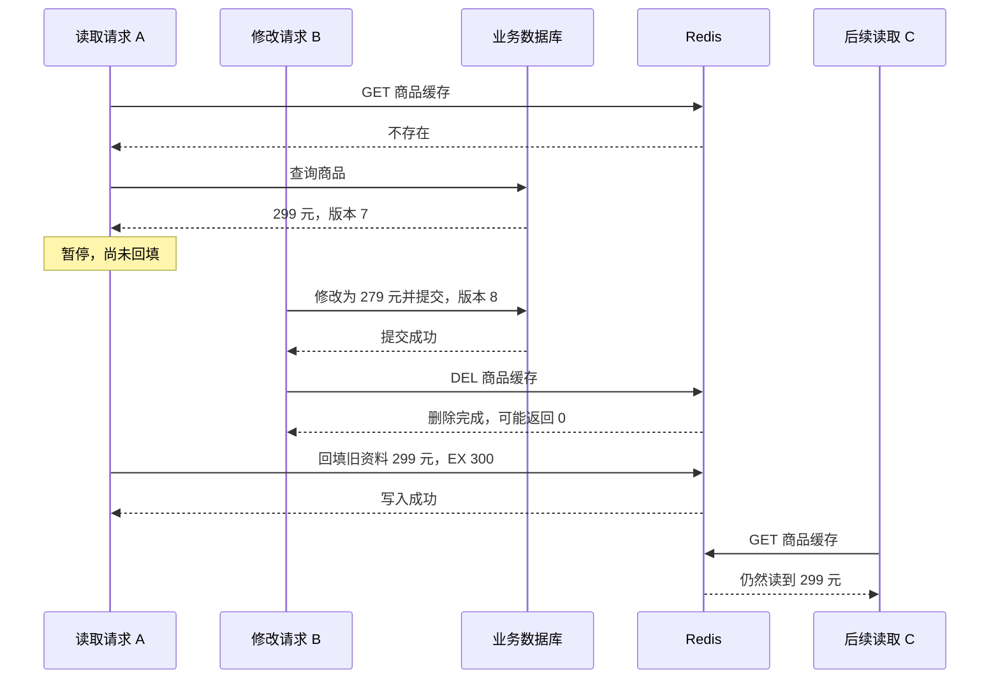

记录时间：2026-10-19 17:51:39 (Asia/Shanghai)

**第11章｜缓存一致性：商品改价后怎样处理缓存**

**问题发生在两个副本之间**

商品 1001 原价 299 元，商家把它改为 279 元。数据库中的更新已经提交，顾客刷新详情页，却仍然看见 299 元。此时 Redis 可能工作正常，网络也没有断开，问题在于应用保存了两份资料，而修改并没有同时作用到两份资料上。

缓存一致性讨论的，就是这两个副本怎样跟上彼此的变化。对本例来说，业务数据库是正式来源，Redis 中的商品信息是可重新生成的副本。详情页能接受多少时间的旧资料，需要由业务确定；下单、计价等流程则应按照自己的正确性要求校验价格，不能直接把展示缓存当作所有交易的依据。官方的 [缓存一致性讨论](https://redis.io/blog/cache-consistency-strategies/) 说明了多份数据在时间与请求顺序上的协调问题。

**先理解常见的更新主线**

在 Cache-Aside 中，常见做法是先更新数据库，确认事务提交成功，再删除商品缓存。删除后，下一次读取查不到副本，就去数据库重新加载 279 元。这里的“更新成功”必须指提交完成；如果只是执行了 SQL、事务还没提交就删缓存，其他请求仍可能读到旧记录。

为什么选择删除？假设缓存里还有格式化介绍、优惠展示等组合内容，逐个同步容易漏掉字段。删除让读取路径统一从正式来源重新组装结果，也避免某些直接覆盖缓存的顺序问题。比如两次改价按顺序提交了 279 元和 259 元，但写缓存的网络请求反向到达，最后反而留下 279 元。删除操作不直接携带旧商品值，通常更容易处理。官方 [Cache-Aside 示例的失效路径](https://redis.io/docs/latest/develop/use-cases/cache-aside/redis-py/) 采用了更新正式来源后删除缓存的方式。

教学伪代码可以很短，但两步之间的失败分支不能省略到脑海之外。下面只展示意图，不是一套可直接上线的同步框架。

```python
# 教学伪代码：数据库提交与缓存删除是两次独立操作
version = database.commit_product_update(1001, price_cents=27900)
try:
    cache.delete("learn:redis:product:1001")
except CacheFailure:
    record_invalidation_for_retry(product_id=1001, version=version)
```

**为什么顺序正确，也仍有竞态**

假设商品缓存恰好不存在。读取请求 A 查询数据库，已经取得旧价格 299 元，但还没写回 Redis。修改请求 B 随后把价格改为 279 元并提交，再删除缓存。删除成功后，A 才继续运行，把此前读到的 299 元写进 Redis。这时数据库是新值，缓存又变成了旧值。



这条时间线说明，删除缓存和回填缓存来自不同请求，不能只沿着一条更新函数看问题。先删缓存、再更新数据库也有明显风险：删除后数据库尚未更新，另一个请求就可能加载旧值。改变两步顺序，不能让数据库与 Redis 自动成为一个原子整体。

**删除失败与删除零个 Key，要分开判断**

`DEL` 返回删除的 Key 数量。对单个商品 Key，返回 `0` 可能表示它本来就不存在，这次操作已经达到了“该缓存不存在”的目标，应与连接失败区分开。网络超时则可能意味着命令没到，也可能已经执行，只是响应没回来，应用不能据此确定最终状态。参见 [DEL 命令返回值](https://redis.io/docs/latest/commands/del/)。

如果数据库提交成功后进程立刻退出，直接调用删除的代码甚至没有机会运行。仅仅在异常里打印一行日志，不能让系统日后自动补上这次删除。较可靠的做法是把“商品已更新，需要使缓存失效”作为可持久保存、可重试、可监测的工作来处理。

例如，具备相应事务能力的数据库可以在修改商品的同一事务中记录一条待发送事件，再由后台任务发送并确认处理。这类设计常叫事务性发件箱。重点在于商品提交与记录待办之间不再留下同样的空隙；它仍然需要投递、确认、重试和积压监测，不能因为使用了消息系统，就认为所有步骤天然不会丢失。

**重试、幂等与版本各解决什么**

删除同一个 Key 多次，不会把旧商品写回来，所以删除比较容易做成幂等动作。重复事件仍可能把刚重建的新缓存删掉，让后续请求多查一次数据库；“重复处理不破坏商品事实”与“重复处理没有成本”并不是一回事。重试还需要退避和告警，避免故障期间持续给 Redis 施压。

事件同步可以补偿遗漏的失效操作，但延迟投递时，旧缓存仍可能被读取。事件重复和乱序也要设计处理方式。对仅执行删除的事件，旧事件通常带来额外未命中；对携带商品资料、直接更新缓存的事件，乱序更可能用旧版本覆盖新版本。两种消费者不能简单复用同一套假设。

给商品附上递增版本，例如 7、8、9，有助于识别旧资料，但只在 JSON 里多加一个版本字段没有作用。必须有比较规则，并让比较与写入成为不可被其他请求插入的操作。Redis 的脚本可以提供 Redis 内部的原子执行，不过这个原子范围不包括外部数据库。参见 [Redis 脚本原子执行说明](https://redis.io/docs/latest/develop/programmability/eval-intro/)。

还有一个细节：如果新缓存已经被删光，慢请求拿着版本 7 回填，根本没有现存的版本 8 可供比较。要阻止它，可能需要保留“最低允许版本”等额外状态，并设计其保留时间、更新顺序和故障恢复；也可以让过久的加载任务失效。完整协议必须把删除后的空档、慢任务和数据源读取延迟一起考虑。版本号是设计材料，并不是贴上就能生效的保证。

**TTL、锁和延时删除的实际边界**

过期时间可以减少一份旧缓存长期停留的风险。假设旧资料在 10:00:10 才回填并设置 300 秒 TTL，期限从这次写入开始计算，而不是从商家 10:00:00 改价开始计算。如果旧资料不断被重新写入并续期，或者回源查询本身持续读到滞后的副本，就不能承诺从改价起 300 秒内一定全部变新。Redis 负责 Key 的期限，业务负责写进去的值。参见 [EXPIRE 的期限语义](https://redis.io/docs/latest/commands/expire/)。

有人会在第一次删除后等一段时间再删一次，试图覆盖慢请求回填，这常被称作延时双删。它可以降低特定时间线出现旧值的概率，但等待多久才能覆盖所有请求、第二次删除失败怎么办，仍然要回答。锁也要处理租约到期、持有者暂停以及所有读写路径是否遵守协议。没有这些条件，固定等待、加锁和 TTL 都不能独自提供绝对的一致性。

**怎样选择，怎样练习**

对可容忍短暂旧数据的商品介绍页，可以从数据库提交后失效、可靠补偿和合理 TTL 开始，再用监测检查旧值窗口和重试积压。对要求更严格的关键读取，可以选择从具备所需一致性保证的数据源直接读取，或者设计更完整的同步协议。应先写清业务允许什么，再决定愿意付出多少查询、同步与运维成本。

短练习：把上面的时序图重画一次，让 A 的回填写在 B 删除之前，判断后续读取结果；再让 B 的删除请求超时，分别列出“实际执行了”和“实际未执行”两种情况。最后解释：仅给商品 JSON 加上版本号，为什么不能阻止缓存被删除后发生的旧回填？能回答这些问题，就不会把某条常见口诀误当成无条件的正确性证明。

**官方资料**

可继续查阅 [缓存一致性策略](https://redis.io/blog/cache-consistency-strategies/)、[Cache-Aside 实现示例](https://redis.io/docs/latest/develop/use-cases/cache-aside/redis-py/)、[DEL](https://redis.io/docs/latest/commands/del/)、[脚本执行](https://redis.io/docs/latest/develop/programmability/eval-intro/) 和 [EXPIRE](https://redis.io/docs/latest/commands/expire/)。

[上一章](./2026-10-19-175139-10-Cache-Aside旁路缓存.md) · [返回目录](./2026-10-19-175139-Redis入门目录.md) · [下一章](./2026-10-19-175139-12-内存淘汰.md) · [Notion 本章](https://app.notion.com/p/3fef19459cb281c3817bc0ade21300b5?pvs=204)

扩写关联：[上一版学习记录](../2026-10-19-174516-Redis入门分章/2026-10-19-174516-11-缓存一致性.md)。本版补充了机制解释、案例过程、预期现象、方案取舍及练习。
