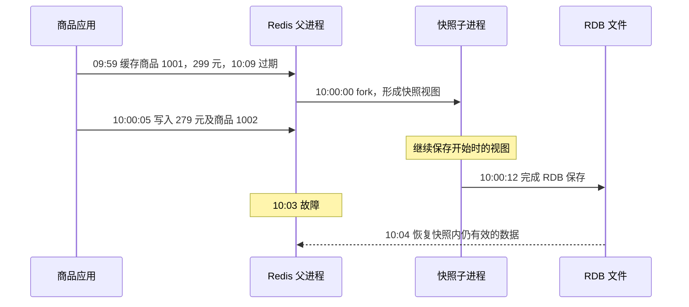

记录时间：2026-10-19 17:51:39 (Asia/Shanghai)

**第13章｜RDB：给 Redis 数据拍一张快照**

**缓存放在内存里，重启以后怎么办**

我们已经能把商品资料放进 Redis，也知道缓存可能过期或被淘汰。接下来再考虑一种情况：Redis 所在进程异常退出，内存状态不能继续使用。如果磁盘上保存过一份数据记录，重新启动时就有机会从它恢复，而不是完全从空状态开始。

把数据保存到可在重启后使用的介质上，叫持久化。RDB 是 Redis 的一种持久化方式，它保存某个时间点的数据快照。可以把它想成给商品资料架拍了一张照片：照片能够帮助恢复拍摄时的摆放情况，却看不到拍照后新放进去的资料。官方 [持久化说明中的 RDB 部分](https://redis.io/docs/latest/operate/oss_and_stack/management/persistence/) 介绍了这种时间点快照。

**快照记录的是状态，不是持续录像**

假设快照里保存着商品 1001 的名称与 299 元价格。之后商家改价，应用删除了旧缓存，又加载了 279 元的新资料。运行中的 Redis 已经有新状态，但之前完成的那份 RDB 文件仍然代表旧的快照。除非后来又有新的成功保存，否则它不会随着每条写命令自行更新。

这意味着 RDB 的数据丢失窗口与成功快照之间的间隔有关。生成快照的计划再频繁，也要考虑某次任务是否真的完成、磁盘是否可写、是否存在更新的可恢复文件。配置了计划与拥有最近的成功快照，属于两件需要分别确认的事。对商品缓存来说，丢失一部分副本通常可以通过查询数据库重建，但恢复旧副本也可能影响展示，不能只统计恢复了多少 Key。

**后台保存怎样同时面对读写请求**

Redis 提供 `BGSAVE` 来触发后台保存。常见的 Redis Open Source 运行方式中，它通过 `fork` 创建子进程，父进程继续服务客户端，子进程负责把它看到的数据写成 RDB 文件。这让耗时的文件生成不必全部挤在处理请求的路径里。命令返回后台保存已启动，并不等于磁盘文件已经成功完成。参见 [BGSAVE 命令说明](https://redis.io/docs/latest/commands/bgsave/)。

关键在于父子进程怎样共享内存。开始时，它们可以共享相同的内存页。父进程后来修改某个页时，操作系统利用写时复制，也就是 Copy-on-Write，保留子进程所需的旧内容，让父进程继续使用修改后的内容。这样，子进程生成的是分离出来的快照视图，不会因为父进程后续不断改价，就把文件变成随写入顺序漂移的一锅资料。

可以用复印资料来理解：开始时大家共同阅读同一份原稿，只有某页要改动，才另外保留一份，使保存任务仍然能读到之前的版本。这是帮助理解的比喻，实际操作按内存页发生，不是按照一个商品字段复制一次。快照对应的状态边界在后台任务开始时形成，文件可能过了一段时间才写完；不能把“文件完成时间”当作它包含所有写入的截止时间。

**后台进行，也仍然有成本**

`fork` 本身需要处理页表等结构，可能让主线程出现延迟；数据集越大、运行环境越紧张，这个影响越需要观察。保存期间如果商品缓存被大量修改，更多内存页触发写时复制，额外内存也会增长。子进程写文件还会消耗 CPU 和磁盘带宽，所以“后台保存”不能理解为对线上请求完全没有影响。[Redis 官方延迟诊断](https://redis.io/docs/latest/operate/oss_and_stack/management/optimization/latency/) 专门讨论了 `fork` 和相关资源压力。

因此，不能只给正常运行时的数据预留内存，然后假设快照任务可以免费完成；也不能用一个固定倍数承诺所有数据集的峰值内存。写入的页分布、保存耗时和系统行为都会影响结果。RDB 是否适合当前负载，应通过实际资源观察判断，而不是只因为文件比较紧凑就忽略生成过程。

**用一次事故时间线判断能恢复什么**

下面是纸面推演，假设只使用这份 RDB 恢复，没有更新的快照、AOF 或其他恢复来源。09:59，商品 1001 被缓存为 299 元，绝对过期时间为 10:09。10:00:00 开始后台快照，10:00:05 应用加载了新价格 279 元，并首次缓存商品 1002。10:00:12，后台保存完成。随后 10:03 发生故障，10:04 从这份 RDB 恢复。



恢复后，商品 1002 可能不存在，因为它在快照视图形成后才加入。商品 1001 则可能仍是 299 元，因为后来修改的 279 元没有进入这份快照。即使文件在 10:00:12 才完成，也不能因此认为它必然包含 10:00:05 的修改。应用需要把这些恢复结果与业务数据库中的正式资料区分开。

如果商家修改商品时曾经删除过旧缓存，这次删除发生在快照之后，也可能没有被这份快照记录。因而恢复旧快照时，尚未到期的旧副本可能重新出现。它是否能够直接用于展示，需要沿用“缓存一致性”一章讨论的有效性与失效策略，而不能因为恢复成功就默认最新。

**过期时间不会因为关机暂停**

刚才假设 10:04 恢复，商品 1001 的期限原本是 10:09，在时间正常的情况下，它剩下的是约 5 分钟，而不是重新获得完整的 10 分钟。如果直到 10:10 才恢复，这个 Key 的期限已经过去，不能作为有效缓存继续读出来。

Redis 保存的过期信息使用绝对 Unix 时间戳，时间在实例停止期间仍然流逝；跨机器恢复时，机器时钟也会影响判断。因此需要保持系统时间稳定。参见 [EXPIRE 的持久化与时间语义](https://redis.io/docs/latest/commands/expire/)。这里说的“旧副本可能回来”针对仍在有效期限内的数据，并不是说已经到期的 Key 会在正常时钟条件下重新活一轮。

**怎样只读地检查保存状态**

如果有相应权限，可以读取以下信息。本章只展示只读检查，不要求执行保存、重启或恢复，也没有改变任何 Redis 配置。

```text
INFO persistence
INFO stats
LASTSAVE
```

`INFO persistence` 中，`rdb_bgsave_in_progress` 说明当前是否在后台保存，`rdb_last_bgsave_status` 说明最近一次后台保存结果，`rdb_last_bgsave_time_sec` 反映耗时，`rdb_last_cow_size` 则帮助观察最近一次保存的写时复制开销。`INFO stats` 里的 `latest_fork_usec` 可以辅助观察最近 `fork` 的用时。字段随版本可能有所不同，含义见 [INFO 官方参考](https://redis.io/docs/latest/commands/info/)。

`LASTSAVE` 返回最近成功保存的时间信息，但 Redis 启动时也会初始化相关状态，所以不能看到一个看似很新的时间，就直接证明刚生成了一份新备份。应结合进程启动记录、保存状态和实际恢复验证理解。这个细节见 [LASTSAVE 官方说明](https://redis.io/docs/latest/commands/lastsave/)。备份文件存在、保存成功与业务能够从中恢复，也需要分别验证。

**怎样取舍与练习**

RDB 文件紧凑、便于保留多个时间点，适合备份和恢复一批状态。它的代价是快照生成成本，以及快照点之后的变更可能丢失。对能够从数据库重建的商品缓存，是否需要持久化，还要比较恢复缓存的收益与保存成本；对不能丢失的重要状态，应另行制定耐久性要求，不能沿用缓存副本的假设。

短练习：沿用事故时间线，把恢复时间分别改为 10:04 和 10:10，判断商品 1001 是否可能读取、价格是否一定最新；再把商品 1002 的首次缓存时间改为 09:59:30，说明答案怎样变化。最后解释：后台保存已经启动、后台保存已经成功、备份已经通过恢复验证，为什么是三个不同的结论。

**官方资料**

可继续查阅 [Redis 持久化](https://redis.io/docs/latest/operate/oss_and_stack/management/persistence/)、[BGSAVE](https://redis.io/docs/latest/commands/bgsave/)、[延迟诊断](https://redis.io/docs/latest/operate/oss_and_stack/management/optimization/latency/)、[EXPIRE](https://redis.io/docs/latest/commands/expire/) 和 [INFO](https://redis.io/docs/latest/commands/info/)。记录持续写入的另一种持久化方式，放在下一章 AOF 中单独学习。

[上一章](./2026-10-19-175139-12-内存淘汰.md) · [返回目录](./2026-10-19-175139-Redis入门目录.md) · [下一章](./2026-10-19-175139-14-AOF日志.md) · [Notion 本章](https://app.notion.com/p/3fef19459cb281d99f5de375a7b63308?pvs=204)

扩写关联：[上一版学习记录](../2026-10-19-174516-Redis入门分章/2026-10-19-174516-13-RDB快照.md)。本版补充了机制解释、案例过程、预期现象、方案取舍及练习。
