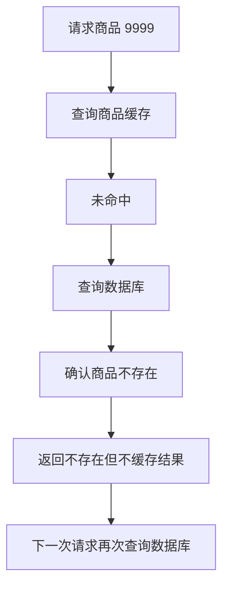

记录时间：2026-10-19 17:51:39 (Asia/Shanghai)

**第15章｜缓存穿透：不存在的商品被反复查询**

**本章问题：商品不存在，数据库为什么还要一直查？**

用户打开商品 1001，应用能从缓存取得详情；打开商品 9999，却总是查数据库。你可能会觉得：“查不到就返回不存在，事情已经结束了。”但这个结论只对当前请求成立。如果下一位用户又查询商品 9999，应用仍不知道它刚刚被查过，于是再走一遍数据库。

当请求的商品在数据库里根本不存在，而应用又持续把这些请求送到数据库时，通常就称为缓存穿透。请求可能来自输错链接、过期的页面、程序错误，也可能来自恶意扫描。先理解数据和请求的行为，再判断来源，才能选对处理方式。

**发生过程：没有保存“查不到”，就无法复用这个结果**

假设商品 9999 从未创建。第一次请求到达时，Redis 中没有对应 Key。应用查询数据库，数据库返回没有这条记录。应用把“商品不存在”返回给用户，但没有在 Redis 中留下任何信息。

第二次请求到达后，Redis 仍然没有这个 Key。对于应用而言，这与“一个真实商品只是还没缓存”完全一样。于是它再次查询数据库。即使数据库能很快判断不存在，连接、执行和结果处理仍然消耗资源；请求足够多时，这些重复工作会挤占正常业务的容量。

**怎样识别：要看数据库查到了什么**

缓存未命中率升高只能说明“请求没有直接取得缓存”，无法单独证明穿透。刚上线、缓存重建和数据淘汰，也可能让未命中增加。更有区分度的现象是：数据库查询次数增加，同时“商品不存在”的比例明显升高。

可以在应用中分别统计正常商品命中、空结果命中、回源查到商品、回源没有商品这几种结果，再观察请求集中在少数编号，还是不断更换编号。若大量请求重复访问同一个缺失商品，短期空结果缓存往往很有针对性；若编号几乎每次不同，处理重点就要向入口控制和容量限制移动。

Redis 的 `INFO` 提供 `keyspace_hits`、`keyspace_misses` 等整体指标，但 Redis 不知道某个字符串代表“商品不存在”。业务统计应由应用补充。比较指标时也应关注同一时间窗口的增量，不能把运行以来的累计次数直接当成当前每秒请求量。[INFO 官方说明](https://redis.io/docs/latest/commands/info/)

**第一层处理：校验明显不合理的输入**

商品编号要求是正整数，就可以在入口拒绝负数、超长字符串或不符合约定的格式。这样无需访问 Redis 和数据库，就能消除一部分没有意义的请求。校验还要遵循业务实际，不能因为当前商品最大编号是某个值，就永久把更大的编号都判为非法，否则后来新增商品可能被误拦。

参数合法与商品存在是两个判断。编号 9999 完全可能符合格式，却没有对应商品。校验因此是第一道筛选，不能替代存在性检查。接口的访问权限也需要独立判断，不能把“商品缓存命中”当作“当前用户有权查看”的依据。

**第二层处理：把“确实不存在”也短期保存起来**

数据库确认商品不存在后，可以写入一个约定的标记，例如结构中明确记录 `status: not_found`，并设置较短的 TTL。下次请求读取到这个标记，便直接返回不存在。这里保存的是一次查询结论，也叫负缓存或空结果缓存。[Redis 官方缺失记录处理说明](https://redis.io/docs/latest/develop/use-cases/cache-aside/redis-py/#handle-missing-records-explicitly)

必须区分三种状态：有正常商品、缓存了不存在、完全没有缓存。不能随手用空字符串代表全部情况，然后用“值是不是空”判断是否命中，否则空结果标记会被误认成未命中，数据库仍然不断被查询。标记也不宜与合法商品内容混淆，应让读写双方遵守同一表示方式。

下面是教学推演，并非实测：假设每秒有 100 个请求访问同一个不存在的编号，持续 60 秒。未缓存空结果时，最多可能产生约 6000 次重复查询。若用 30 秒空结果缓存，理想的顺序场景下，只需要在少数到期时刻重新确认，而非每次都查。并发请求、写缓存失败和提前淘汰都会改变实际次数，不能把这个算式当作效果保证。

空结果期限越长，重复查询越少，但新商品越可能暂时被旧结论遮住。若 10:00 查不到商品，10:01 商家刚创建它，旧标记仍有效，用户可能继续看到不存在。因此新增商品成功后，应安排使相关空结果失效，并考虑删除失败的重试。TTL 提供后续再次确认的机会，显式失效则帮助缩短可见延迟。并发旧查询稍后写回空结果的情况，仍属于需要结合写入顺序处理的一致性问题。

**第三层处理：防止“缓存不存在”本身占满内存**

如果请求不断生成随机编号，每个编号只访问一次，空结果几乎没有复用价值。应用却为每个编号创建一个 Key，短时间内也会产生大量缓存数据。即使每份标记很小，Key、过期信息和管理开销加起来仍然占内存，甚至可能挤掉正常商品缓存。

因此空结果缓存也需要容量意识：期限保持合理，观察数量与命中情况，结合调用方限流、异常请求治理和数据库回源预算。限流既可以针对明显异常的调用方，也需要关注整体容量，避免“每个用户都没超限，合计却超过数据库承受能力”。不要只因为空结果很小，就允许无限写入。达到内存上限后的行为还受淘汰策略影响。[Redis 官方淘汰策略说明](https://redis.io/docs/latest/develop/reference/eviction/)

**可选补充：用布隆过滤器提前排除一部分编号**

商品编号集合很大时，可以考虑布隆过滤器。它用较少空间帮助判断某个编号是否属于已经加入的集合：回答“可能存在”时仍要继续查，回答“不存在”时才可据集合状态排除。它存在误判，也就是把未加入的编号回答为“可能存在”，所以仍会有部分无效请求通过。[Redis 官方 Bloom filter 说明](https://redis.io/docs/latest/data-types/probabilistic/bloom-filter/)

“不会漏掉已经加入的元素”有前提：过滤器本身正常，真实商品已经成功同步进去。新商品已创建却尚未加入过滤器时，应用仍可能把它误拒绝；这属于维护流程的遗漏，不能靠数据结构的性质自动修复。还要考虑初始化、重建和更新失败，传统布隆过滤器也不支持随意删除单个成员。对于小项目，先把参数校验、空结果语义和新增失效做好，通常更容易验证。

**容易弄错的地方与思考练习**

数据库连接超时，代表当前没有取得查询结论，不代表商品不存在。把超时也缓存成不存在，会把基础设施故障变成错误业务结果。对失败应走明确的错误或降级处理，对“确认不存在”才使用空结果缓存。

思考一个场景：日志显示每分钟访问一万个不同的商品编号，只有很少编号重复。此时把空结果期限从 30 秒延长到半小时，可能减少多少查询，又会增加多少无效 Key？再想想，如果今晚要批量上架这些编号，哪些旧结论需要清理。能回答这两个问题，就说明你已经开始从请求复用和数据变化两方面选择策略。

本章资料可继续核对：[缺失记录与短期标记](https://redis.io/docs/latest/develop/use-cases/cache-aside/redis-py/#handle-missing-records-explicitly)、[BF.EXISTS 的存在性语义](https://redis.io/docs/latest/commands/bf.exists/)、[Bloom filter 容量与误判](https://redis.io/docs/latest/data-types/probabilistic/bloom-filter/)、[内存淘汰与缓存指标](https://redis.io/docs/latest/develop/reference/eviction/)。

[上一章](./2026-10-19-175139-14-AOF日志.md) · [返回目录](./2026-10-19-175139-Redis入门目录.md) · [下一章](./2026-10-19-175139-16-缓存击穿.md) · [Notion 本章](https://app.notion.com/p/3fef19459cb28189a77ad808cee8b1e4?pvs=204)

扩写关联：[上一版学习记录](../2026-10-19-174516-Redis入门分章/2026-10-19-174516-15-缓存穿透.md)。本版补充了机制解释、案例过程、预期现象、方案取舍及练习。
