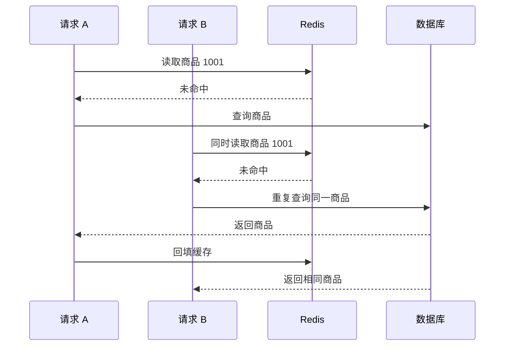

记录时间：2026-10-19 17:51:39 (Asia/Shanghai)

**第16章｜缓存击穿：热门商品缓存失效**

**本章问题：一个热门商品的缓存过期，为什么数据库突然忙起来？**

商品 1001 正在促销，商品本身真实存在，过去几分钟的访问也一直很顺畅。直到它的缓存过期，接口突然变慢，数据库出现大量针对商品 1001 的相同查询。缓存稍后重新写好，流量又恢复平稳。

这类一个热点 Key 失效后，大量并发请求同时回源查询的情况，通常称为缓存击穿。这里的“回源”就是到数据库等正式数据来源重新加载。理解它的关键，在于把“一个请求未命中”和“很多请求在同一个空窗中未命中”区分开。

**发生过程：新的缓存还没写好，后面的请求已经来了**

假设缓存读取很快，而数据库加载商品需要一小段时间。请求 A 发现缓存没有了，开始查询数据库。在它等待结果时，请求 B、C、D 已经到达。它们看到的也是没有缓存，于是分别发起查询。最后大家获得相同商品，又重复写入同一个 Key。

下面是教学假设，非实测：每秒 2000 个请求均匀访问商品 1001，单次数据库加载需要 100 毫秒。首次回填完成之前，约有 200 个请求进入这个窗口。如果它们都独立回源，就可能产生约 200 份相同查询。数据库排队后延迟变长，空窗也变长，更多请求会继续加入，形成放大过程。真实数量受请求分布和并发限制影响，不能直接照搬。

**怎样识别：看查询是否集中在同一个热点**

可以先观察商品维度的回源次数和时间分布：是否在某个 Key 失效后出现尖峰，尖峰中的查询是否反复指向同一商品，缓存恢复后查询量是否下降。接口的高分位延迟、数据库活动连接和等待连接数，可以帮助判断重复查询是否已经造成排队。

只看全站平均缓存命中率容易忽略热点。一个商品只占全部 Key 的很小部分，却可能承载大量访问。应用应记录同 Key 并发加载数、加载耗时和等待者超时数等有针对性的指标。Redis 的 `expired_keys`、`evicted_keys` 可以帮助排查缓存消失是否与过期或内存淘汰有关，但整体计数不能直接证明某个商品发生了击穿。[INFO 官方指标说明](https://redis.io/docs/latest/commands/info/)

**第一种处理：把相同 Key 的加载合并起来**

当很多请求都想加载商品 1001 时，可以让其中一个负责查询数据库，其他请求等待它的结果，再共享回填后的缓存。这个思路常被称为请求合并或 single-flight。它减少的是“同一个商品同时被重复加载”，并没有减少所有不同商品的首次查询。[Redis 官方 Cache-Aside 并发加载说明](https://redis.io/docs/latest/develop/use-cases/cache-aside/redis-py/#stampede-protection-with-a-lua-lock)

如果应用只有一个进程，可以在进程内协调；如果有多个应用实例，每个实例各自合并，只能把每个实例内部的重复请求压下来。十个实例仍然可能各发一次相同查询。若需要进一步减少跨实例重复加载，就要让这些实例共享协调机制，并评估它的失败边界。多一次协调也会增加复杂度，应根据数据库预算选择，而非一开始就追求绝对只查一次。

取得加载资格后，通常还应再查一次缓存。原因是请求从首次未命中到取得资格之间，可能已经过了几十毫秒：前一个加载者刚好写入并退出，此时再查就能复用结果，不必又访问数据库。这一步通常叫二次检查。它只有在检查和后续加载遵循同一套协调规则时才有意义，不能独立替代协调机制。

**等待和失败也必须是流程的一部分**

其他请求不能无限等待。商品接口有自己的响应时间预算，等候达到上限时，应根据业务返回稍后重试、明确错误，或使用允许的旧值。若等待一到期就让所有请求一起查询数据库，原本被压住的请求仍会在同一时刻释放，因此等待结束后的行为也需要受回源预算约束。

负责加载的请求也可能遇到数据库超时、回填失败或进程退出。系统需要让后续请求能够重新尝试，又不能形成毫无间隔的集体重试。可以限制尝试次数、设置退避，并在必要时加入随机间隔。超时应同时考虑数据库、协调等待和整个接口的剩余预算，不能各层都等待很久，最后叠成一个远超预期的响应时间。[Redis 官方客户端超时说明](https://redis.io/docs/latest/develop/clients/redis-py/produsage/#timeouts)

**使用锁协调时，先弄清“资格能持续多久”**

跨实例请求合并常使用锁，但仅会写一条加锁命令远远不够。锁通常有有效期，避免加载者退出后其他请求永久等下去。如果数据库意外变慢，加载尚未完成，锁已经过期，另一个请求就可能取得资格。此时两个加载者可能同时存在，不能宣称“有锁就绝不会重复查询”。

释放锁还必须确认它仍属于当前请求。否则原请求恢复后，可能删除后来请求刚取得的锁。所有权检查需要与释放组成不可分割的操作；不能先读取标识，再在另一步无条件删除。锁失效后，旧加载者继续回写是否会覆盖较新结果，也需要结合版本、任务取消或其他写入约束处理。所有权标识帮助安全释放，但不会自动阻止已经失去资格的进程继续执行。[Redis 官方分布式锁说明](https://redis.io/docs/latest/develop/clients/patterns/distributed-locks/)

这些问题涉及有效期、网络故障和数据新旧关系，因此本章不提供几行“万能锁代码”。使用经过验证的协调库，也仍需理解它在当前部署方式中的保证和限制。这里的目标是减少缓存重建的重复工作，不能把同一套简化思路直接用于扣款或库存正确性。

**第二种处理：尽量不要等热点彻底消失才刷新**

已知活动商品持续热门时，可以在到期前安排受控刷新，让新值接替旧值，减少空窗。刷新任务同样需要合并、错峰和失败处理，否则多个实例一起刷新，依然会造成重复加载。若所有商品都定时刷新，还可能把本来没人访问的数据也反复查一遍，因此更适合确有价值的热点。

对于允许短期陈旧的展示内容，还可以设计“先返回旧值，后台刷新”的流程。这要求业务明确最长可接受的陈旧时间，并保留可用旧值；若 Redis 的 Key 已经物理过期，普通 `GET` 不能凭空找回旧内容。后台刷新持续失败时，也不能无限返回旧值。商品介绍可能允许短暂陈旧，结算价格和可售库存则要按相应交易流程校验，不能沿用展示页的宽松条件。

**容易弄错的地方与思考练习**

把所有商品都放在一把全局锁下，会让互不相关的商品互相等待。同 Key 请求合并应保留不同商品之间的正常并发；但不同 Key 的总回源量仍需另行控制。单纯延长热点 TTL 只能降低某些失效的频率，主动删除、淘汰和故障仍会让缓存消失。

思考一个场景：五个应用实例各自做到“同商品只允许一个加载者”，数据库仍看到五次相同查询。先判断这是否超出数据库预算；如果只有五次且影响很小，是否值得增加跨实例协调？如果加载时间突然从 100 毫秒升到 3 秒，等待者和协调有效期又该如何处理？答案应同时照顾重复工作、响应时间和失败恢复。

本章资料可继续核对：[Cache-Aside 与 single-flight](https://redis.io/docs/latest/develop/use-cases/cache-aside/redis-py/)、[锁所有权和有效期](https://redis.io/docs/latest/develop/clients/patterns/distributed-locks/)、[SET 的条件写入与过期选项](https://redis.io/docs/latest/commands/set/)、[客户端重试和超时](https://redis.io/docs/latest/develop/clients/redis-py/produsage/)。

[上一章](./2026-10-19-175139-15-缓存穿透.md) · [返回目录](./2026-10-19-175139-Redis入门目录.md) · [下一章](./2026-10-19-175139-17-缓存雪崩.md) · [Notion 本章](https://app.notion.com/p/3fef19459cb281648006fa8f24de3c7f?pvs=204)

扩写关联：[上一版学习记录](../2026-10-19-174516-Redis入门分章/2026-10-19-174516-16-缓存击穿.md)。本版补充了机制解释、案例过程、预期现象、方案取舍及练习。
