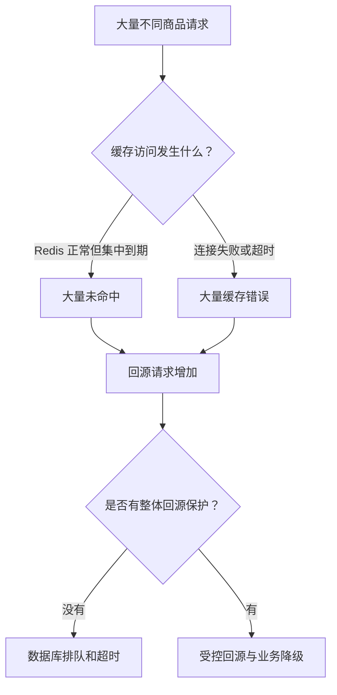

记录时间：2026-10-19 17:51:39 (Asia/Shanghai)

**第17章｜缓存雪崩：大量缓存同时失效**

**本章问题：为什么许多商品会同时失去缓存保护？**

一个热点商品的缓存失效，已经可能引起很多重复查询。再往前想一步：如果一整批商品缓存一起到期，或者应用突然连不上 Redis，会发生什么？这时大量不同请求都可能转向数据库，影响范围从一个商品扩大到整个业务，这类现象通常称为缓存雪崩。

理解雪崩，要把两条路径分开。第一条是 Redis 工作正常，但大量缓存集中失效，应用不断取得“没有这个 Key”的正常结果。第二条是 Redis 访问本身失败，出现连接异常、超时等情况。两者都可能放大数据库压力，但触发原因和优先处理方式并不相同。

**发生过程：数据库突然接到原本由缓存承担的流量**

假设促销前，应用在 19:55 集中写入一大批商品，全部设置五分钟有效。20:00 活动开始时，这批缓存恰好一起到期。用户访问的是不同商品，即使应用已经合并同 Key 请求，也仍然可能出现大量不同 Key 的数据库加载。

另一条路径中，商品缓存原本都在，但 Redis 网络暂时不可达。如果应用的异常处理是“任何缓存错误都直接查数据库”，数据库会在故障时接到大部分访问；如果每次先等待很长时间再回源，应用的线程、连接或任务还可能先被等待拖住。错误处理本身，也会影响故障怎样扩散。[Redis 官方客户端错误处理说明](https://redis.io/docs/latest/develop/clients/error-handling/)

**怎样识别：先分清未命中和访问失败**

可以把应用缓存读取结果分成命中、正常未命中、连接失败、超时和其他错误，分别观察。大量正常未命中伴随过期计数上升，更像集中到期；很多应用实例同时出现连接失败，则应先检查 Redis 服务、网络、连接池和部署事件。超时也可能来自服务拥堵，不能一看到超时就断言 Redis 已经宕机。

还要观察数据库每秒查询数、回源并发、连接池等待、接口错误和高分位延迟。Redis 的 `expired_keys`、`evicted_keys`、内存使用情况能提供线索：集中消失也可能与容量不足、淘汰或批量清理有关。指标应该结合时间窗口增量和事件记录分析；Redis 无法访问时，也不能指望只靠现场查询它来了解全部情况。[Redis 官方缓存指标与淘汰说明](https://redis.io/docs/latest/develop/reference/eviction/)

**用数字看清楚数据库的缺口**

下面全部是教学假设，非实测：商品详情每秒收到 10000 次请求，平时缓存命中率是 95%，数据库约承担 500 次回源。如果缓存突然整体不可用，应用又无条件放行，回源需求就可能接近每秒 10000 次，是原来的约 20 倍。

假设事先压测显示，在当前混合业务负载下，只能为商品详情安全安排每秒 1000 次回源，那么即使数据库比平时多承受一倍，也远接不住所有请求。这里的容量预算要给下单、运营等其他查询留余量，并随查询耗时变化调整，不能只拿数据库宣称的最大连接数来代替吞吐能力。

**第一层处理：分散失效时间，避免自己制造同步点**

给 TTL 增加适当随机变化，可以让同一批写入的商品分批到期。例如业务允许大约五分钟有效，可以为不同商品选择 270 到 330 秒。具体范围要经过业务确认；若要求最多陈旧五分钟，就不能随意把上限扩大到 330 秒，而应选择不超出边界的分布。

它的作用是分散到期时间，不是消灭回源总量。单个热点仍可能在自己的到期时刻击穿；Redis 整体访问失败时，随机 TTL 也没有帮助。批量刷新若又把所有期限统一对齐到某个时刻，还会重新制造同步点。[Redis 官方对 TTL 抖动的说明](https://redis.io/blog/cache-layer-architecture-guide/)

活动前还可以渐进预热：按预计热度，分批加载真正会被访问的商品，让系统在活动前逐步建立缓存。预热应受数据库预算控制，并观察缓存写入速度和内存，不能为了准备活动先把数据库压垮。把所有历史商品一次性装入缓存，既可能浪费空间，也可能让预热流量本身成为问题。

**第二层处理：控制不同 Key 合计能回源多少**

同 Key 请求合并负责减少同一商品的重复加载，整体回源限制则负责控制所有商品合计的压力。可以限制同时进行的数据库加载数量，也可以约束单位时间的进入量。查询变慢时，限制并发尤其重要，因为同样的每秒请求会积累更多进行中的任务。等待队列也必须有边界，不能把压力简单搬进无限队列。

当预算耗尽，业务需要明确降级行为。可以减少非必要推荐信息、对部分访问返回稍后重试，或使用业务允许的旧展示数据。商品数据库查不到，才返回商品不存在；数据库没有预算或请求超时，应返回相应失败，不能用不存在掩盖。下单价格和库存等判断仍需按照各自要求处理。

如果回源限制只放在单个实例上，还要计算实例数量。十个实例各允许每秒 1000 次，并不等于整体每秒只有 1000 次；扩容也可能同时扩大允许流量。整体预算需要协调或合理分摊。在 Redis 故障时，关键保护也不能完全依赖这个已经不可用的 Redis 才能执行。

**第三层处理：超时、熔断和重试要共同受预算约束**

合理的连接和命令超时，可以避免每个请求长时间等一个暂时无法访问的缓存。持续失败达到条件后，可以暂时停止普通请求反复尝试，由少量探测判断是否恢复，这就是熔断的基本思路。熔断打开后该降级还是受控回源，仍由业务和容量决定，不能自动等同于全部放行。[Redis 官方客户端超时说明](https://redis.io/docs/latest/develop/clients/redis-py/produsage/#timeouts)

重试次数越多，不一定恢复越快。原本一万个请求如果每个再试三次，可能把故障期间的工作量成倍放大。重试需要限制次数、退避和随机间隔，并服从整个接口的时间预算。熔断恢复探测也应克制，避免每个实例在同一个时刻同时涌回。

**第四层处理：减少故障影响，并让恢复过程有节奏**

高可用部署和客户端故障切换可以缩短某些节点故障的影响。例如 Sentinel 提供监控、通知和自动故障切换，但切换需要时间，客户端必须正确支持它；主从复制和网络故障也存在边界，不能承诺有副本就零中断、零数据丢失。[Redis 官方 Sentinel 说明](https://redis.io/docs/latest/operate/oss_and_stack/management/sentinel/)

Redis 恢复响应，并不代表缓存已经足够热。若重启后数据不完整、部分 Key 已过期，或者存在大量冷数据请求，立即撤掉全部限制可能再次冲击数据库。更稳妥的恢复过程是保留回源保护，小流量探测，分批预热，观察命中率与数据库负载，再逐步恢复。限流阈值也应随实际容量调整，不能只凭连接恢复就判定业务恢复。

**容易弄错的地方与思考练习**

“加一把锁”和“TTL 加随机数”各自解决部分问题。不同商品很多时，逐 Key 加锁仍可能让数据库同时处理大量加载；全局一把锁又会让正常请求互相阻塞。真正需要的是错峰、同 Key 合并、整体容量保护和失败处理相互配合，并通过可控演练验证故障及恢复两个阶段。

思考一个场景：活动缓存已经使用随机 TTL，Redis 却因网络故障持续超时两分钟。应用应该在什么条件下停止反复等缓存？哪些请求允许受控回源，哪些只能降级？连接恢复后，又用哪些指标决定逐步放开？把这条路径讲清楚，比单独记住某个防雪崩技巧更接近可执行的设计。

本章资料可继续核对：[缓存架构与错峰到期](https://redis.io/blog/cache-layer-architecture-guide/)、[客户端错误处理](https://redis.io/docs/latest/develop/clients/error-handling/)、[连接、重试和超时](https://redis.io/docs/latest/develop/clients/redis-py/produsage/)、[Sentinel 的能力与限制](https://redis.io/docs/latest/operate/oss_and_stack/management/sentinel/)、[INFO 中的运行指标](https://redis.io/docs/latest/commands/info/)。

[上一章](./2026-10-19-175139-16-缓存击穿.md) · [返回目录](./2026-10-19-175139-Redis入门目录.md) · [Notion 本章](https://app.notion.com/p/3fef19459cb2816c97a2cafab3f05804?pvs=204)

扩写关联：[上一版学习记录](../2026-10-19-174516-Redis入门分章/2026-10-19-174516-17-缓存雪崩.md)。本版补充了机制解释、案例过程、预期现象、方案取舍及练习。
