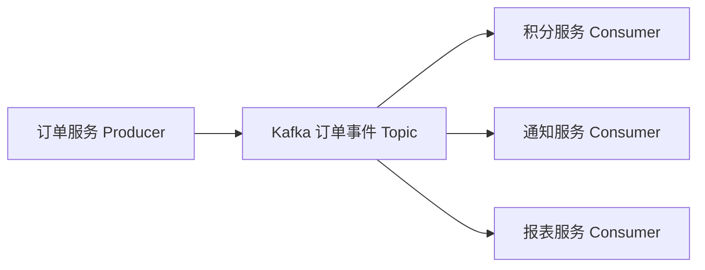

记录时间：2026-10-19 23:11:40 (Asia/Shanghai)

# 第01章｜认识 Kafka：订单事件为什么需要消息平台

## 从“支付成功后还要做什么”开始

订单 `O1001` 已支付，订单服务接下来要通知用户、增加积分、更新报表。若支付接口依次等待三个服务，报表变慢也会拖住用户。把允许稍后完成的工作交给事件消费者，支付流程就能与这些后续动作分别推进。

Kafka 是分布式事件流平台，负责让应用发布、保存、读取事件。“订单已支付”描述一个已发生的事实；“请支付订单”则是一个请求。二者需要不同的业务约定，不能仅靠 Topic 名字互相替代。[Apache Kafka 官方介绍](https://kafka.apache.org/41/getting-started/introduction/)

本系列把 `event_id` 作为事件身份，把 `order_id` 作为业务对象身份。一个订单可以先后产生创建、支付、退款事件，因此两个字段不能互换：

```json
{
  "event_id": "E1001-paid",
  "event_type": "order.paid",
  "order_id": "O1001",
  "amount_cents": 29900,
  "schema_version": 1
}
```

`amount_cents` 明确以分计价。Kafka 保存序列化后的内容，并不会自动校验“金额是否正确”或“订单是否真的支付”。字段含义、事件发布时机和版本兼容由业务系统约定。

## 核心机制：保存一份事实，供多个系统读取

Producer 是写入客户端，Consumer 是读取客户端，Broker 是提供存储和请求服务的 Kafka 节点，Topic 用来组织事件。它们可以位于不同进程和机器。



三个下游使用不同消费组时，可以分别读取同一份事件。积分消费成功不会把通知还没读的消息删掉。事件能否重读，取决于数据是否仍被保留、读取位置及相关清理策略，不能理解成永久存档。

本系列固定以 **Kafka 4.1.2、KRaft、单节点学习环境** 为基线，不把它称作最新版。KRaft 负责 Kafka 集群元数据管理，教程无需额外启动 ZooKeeper。单节点方便理解概念，无法验证多 Broker 容错。[KRaft 与 ZooKeeper 的区别](https://kafka.apache.org/41/getting-started/zk2kraft/)

## 第一次发送和读取

前置条件：Docker 可用，且已按系列目录的环境说明启动名为 `kafka-learn` 的容器。以下命令只使用 `learn-kafka-` 学习命名空间。先准备三分区、单副本 Topic：

```bash
docker exec kafka-learn /opt/kafka/bin/kafka-topics.sh \
  --bootstrap-server localhost:9092 --create --if-not-exists \
  --topic learn-kafka-orders --partitions 3 --replication-factor 1
```

在终端 A 打开生产者，然后输入一整行 JSON，按回车发送：

```bash
docker exec -it kafka-learn /opt/kafka/bin/kafka-console-producer.sh \
  --bootstrap-server localhost:9092 --topic learn-kafka-orders
```

```json
{"event_id":"E1001-paid","event_type":"order.paid","order_id":"O1001","amount_cents":29900,"schema_version":1}
```

在终端 B 读取，首次练习使用一个尚未保存进度的组名：

```bash
docker exec -it kafka-learn /opt/kafka/bin/kafka-console-consumer.sh \
  --bootstrap-server localhost:9092 --topic learn-kafka-orders \
  --group learn-kafka-intro --from-beginning
```

预期终端 B 显示该 JSON；终端 A 通常不会逐条打印业务成功回执。`Ctrl+C` 结束客户端。以上是命令预期现象，本文没有启动容器或实测。若组已有已提交进度，`--from-beginning` 不会强制覆盖它。[官方 Quick Start](https://kafka.apache.org/41/getting-started/quickstart/)

## Kafka 解决问题的边界

Kafka 能缓冲短时流量，但下游长期比上游慢，积压仍会增长；它能解耦服务调用，但事件字段改变仍可能影响下游；发送被确认，也不代表积分已经入账。

尤其要区分“数据库订单已支付”和“支付事件已可靠发布”。这是两个写入，进程可能在中间崩溃。后续会讨论 Outbox 等方案。也不要看到 JSON 出现在控制台，就认为订单接口已经接入 Kafka，真实业务还需要客户端、异常处理、监控和事件契约。

Redis 在本项目常用于加速读取或维护状态，Kafka 主要组织可供下游独立处理的事件流。两者可以一起使用，例如积分消费者收到事件后刷新 Redis 中的积分展示缓存。

## 小练习

把通知客户端的组名换成 `learn-kafka-intro-notify`，再次读取仍被保留的事件。思考：两个客户端用不同组名，与使用相同组名，为什么会有不同现象？再列出支付流程中必须同步完成的动作，以及允许最终完成的动作。

本章扩写关联：[Kafka 在实际开发中的用途](../2026-09-22-112448-Kafka实际开发用途.md)。学习数据由后续章节继续使用，整套练习结束再按目录说明统一清理。

---

[返回目录](./2026-10-19-231140-Kafka入门目录.md) · [下一章](./2026-10-19-231140-02-Topic与Partition.md)
