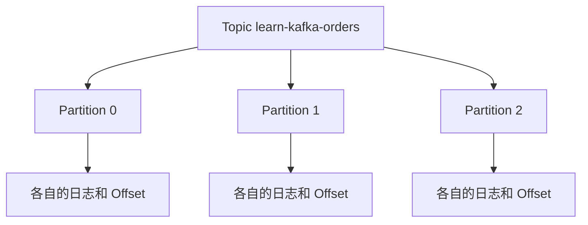

记录时间：2026-10-19 23:11:40 (Asia/Shanghai)

# 第02章｜Topic 与 Partition：订单事件怎样分开保存

## 先确定事件属于哪个业务集合

假设订单系统持续产生支付事件，Kafka 需要知道把它们写到哪里。`learn-kafka-orders` 是本系列的 Topic，表示一个约定好的业务事件集合。名字可以帮助人理解用途，但不会自动创建数据库表结构，也不会自动给 JSON 字段建立索引。

是否把创建、支付和退款事件放在同一个 Topic，要看它们的订阅范围、访问权限、保留要求与顺序要求。本系列为了贯穿订单生命周期，把事件类型放进 `event_type` 字段。真实项目需要形成明确契约，不能只按“所有 JSON 都长得差不多”分组。

## 核心机制：Topic 内部分成多个有序日志

一个 Topic 可以包含多个 Partition。记录追加到其中一个分区，而不是复制到每个分区。每个分区有自己的 Offset，用来标识该日志里的位置。讨论位置时至少要带上 Topic、Partition、Offset 三项；分区 0 的 Offset 10 与分区 1 的 Offset 10 是两条不同记录。[官方介绍：Topic 与分区](https://kafka.apache.org/41/getting-started/introduction/)



分区是存储分布与普通消费组并行分工的重要单位。三个分区能交给多个消费者分担，但不表示一定需要三台服务器；单 Broker 也可以保存三个分区。相反，多台 Broker 并不会让只有一个分区的 Topic 自动变成多个分区。

副本数是另一个维度：三个分区、一个副本，意味着三份不同日志各有一份存储；三个分区、三个副本，则是每个分区有三份副本。不要把“分成三段”当成“备份三份”。单节点学习环境只能合理使用副本数 1。

## 创建后先检查，再发送

前置条件是目录说明中的 `kafka-learn` 容器已经运行。下面命令可创建学习 Topic；若已存在，`--if-not-exists` 不会修改其分区数：

```bash
docker exec kafka-learn /opt/kafka/bin/kafka-topics.sh \
  --bootstrap-server localhost:9092 --create --if-not-exists \
  --topic learn-kafka-orders --partitions 3 --replication-factor 1

docker exec kafka-learn /opt/kafka/bin/kafka-topics.sh \
  --bootstrap-server localhost:9092 --describe \
  --topic learn-kafka-orders
```

预期描述包含 `PartitionCount: 3`、`ReplicationFactor: 1`，以及编号 0、1、2 的分区信息。Broker 的节点编号、Topic ID 等由环境决定，不应照抄输出。若分区数不同，先核对是否复用了旧 Topic，不要直接删除带业务数据的 Topic。[官方运维：Topic 操作](https://kafka.apache.org/41/operations/basic-kafka-operations/)

接着启动带位置显示的消费者，在另一终端按第 01 章方式输入几条不同订单事件：

```bash
docker exec -it kafka-learn /opt/kafka/bin/kafka-console-consumer.sh \
  --bootstrap-server localhost:9092 --topic learn-kafka-orders \
  --group learn-kafka-partition-observer --from-beginning \
  --property print.partition=true --property print.offset=true
```

预期每条输出带分区和 Offset；不是每个分区都必然立即出现记录，少量无 Key 消息的分布也不保证均匀。这里记录的是教学预期，没有实际执行。Java 客户端读取到的 `ConsumerRecord` 也包含这些定位信息，排查重复和重放时应一起记录。[ConsumerRecord API](https://kafka.apache.org/41/javadoc/org/apache/kafka/clients/consumer/ConsumerRecord.html)

## 设计取舍和常见误区

Kafka 提供分区内的顺序基础，没有为整个多分区 Topic 建立统一先后次序。终端交错打印三个分区的记录，不代表能按屏幕行号还原业务全局顺序。若要查询订单当前状态，通常由消费者整理到数据库、搜索系统或 Redis，再对外查询。

分区也不是越多越好。更多分区带来日志、连接、元数据和协调方面的管理成本。扩容分区后，旧记录不会自动重新分布到新分区，同一 Key 的新记录还可能改变落点。因此决定分区数时，应同时考虑并行度、数据分布和顺序要求。

本章只观察分区结构，不修改现有分区数。Kafka 不支持直接减少一个 Topic 的分区数，需要通过新 Topic 和迁移方案处理，不能把扩分区当作随意可逆的小调整。

## 小练习

设 Topic 有三个分区，每个分区都有一条 Offset 为 0 的记录。它们是否重复？如果日志里只记录 `offset=0`，会丢失哪些排查信息？再用一句话说明三个分区与三个副本分别解决什么问题。

保留本 Topic，供后续 Key、消费组和重放章节继续使用；统一清理方式见系列目录。

---

[上一章](./2026-10-19-231140-01-认识Kafka.md) · [返回目录](./2026-10-19-231140-Kafka入门目录.md) · [下一章](./2026-10-19-231140-03-消息Key与顺序性.md)
