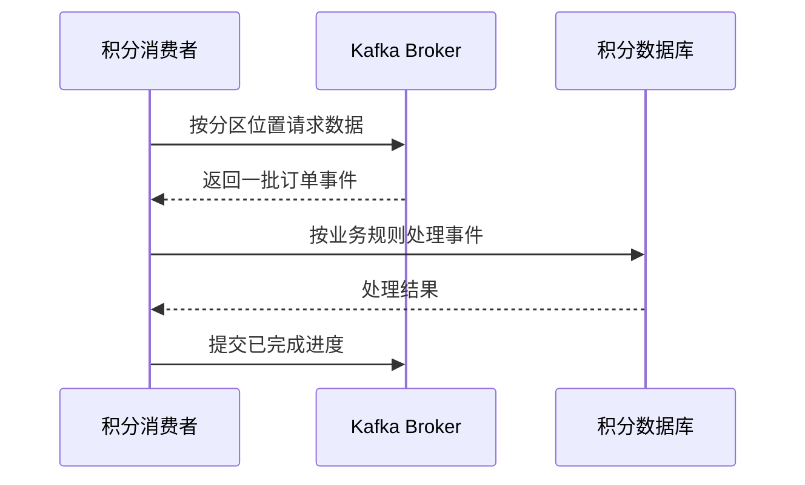

记录时间：2026-10-19 23:11:40 (Asia/Shanghai)

# 第05章｜Consumer 与拉取模型：积分服务怎样按自己的节奏读取

## 消息到达 Kafka 后，积分不会自动变化

Kafka 保存了订单 `O1001` 的支付事件，但积分规则仍需要业务代码执行：校验事件类型和金额、查询规则、更新积分账本。Consumer 是读取事件的客户端，读取成功与业务处理成功应分别记录。

本章讨论普通 `KafkaConsumer` 通过 `subscribe()` 加入消费组的方式，不使用 Share Group，也不使用手动 `assign()`。先建立拉取循环的概念，Offset 提交的完整故障窗口放到后续章节解释。

## 核心机制：客户端发起 Fetch，应用调用 poll

Kafka 的普通消费者采用拉取模型：客户端根据分区位置向 Broker 请求数据，应用通过 `poll()` 获得可供处理的记录。没有数据时，请求可以等待数据到达，应用不必自己写一个不停空转的忙循环。[官方设计：Consumer 拉取模型](https://kafka.apache.org/41/design/design/)



图展示的是一种处理后再提交的教学流程，不表示这两个写入具有原子性。数据库成功而提交进度失败时，后续仍可能重复读取同一事件。

拉取让消费者能够按照处理能力推进，但 Broker 不会因此永远等待慢消费者。数据有保留期限，长期追不上可能失去尚未处理的历史记录。消费者也需要及时维持组成员状态，并在允许的时间内继续调用 `poll()`。

## 先观察控制台读取

前置条件：`kafka-learn` 已运行，前面章节已经向 `learn-kafka-orders` 写入事件：

```bash
docker exec -it kafka-learn /opt/kafka/bin/kafka-console-consumer.sh \
  --bootstrap-server localhost:9092 --topic learn-kafka-orders \
  --group learn-kafka-pull-observer --from-beginning \
  --consumer-property max.poll.records=2 \
  --property print.partition=true --property print.offset=true
```

预期会持续显示事件，暂时没有新事件时等待，而不是立即退出。`max.poll.records=2` 限制一次 `poll()` 交给应用的记录数，不代表控制台每秒只显示两条，也不直接限制底层 Fetch 的字节数。客户端可以提前取回并缓存多条数据，再分次返回。[Consumer 配置](https://kafka.apache.org/41/configuration/consumer-configs/)

组名首次使用时，`--from-beginning` 使没有有效已提交进度的分区从当前最早可用位置读取。若该组已有进度，则通常从进度继续；Kafka 已删除的历史数据也不会因此恢复。上述现象是预期说明，本文没有实际运行命令。

## 业务循环应把“处理完成”写清楚

下面是 **Java 客户端教学伪代码**，省略依赖、导入、退出控制、反序列化配置和完整异常处理，不可直接当作生产程序运行：

```java
props.put("group.id", "learn-kafka-points");
props.put("enable.auto.commit", "false");
props.put("max.poll.records", "50");
consumer.subscribe(List.of("learn-kafka-orders"));
while (running) {
    var records = consumer.poll(Duration.ofSeconds(1));
    for (var record : records) {
        handleOrderEvent(record.value()); // 失败则终止本批处理并恢复
    }
    consumer.commitSync(); // 仅在本批全部处理成功后执行
}
```

`handleOrderEvent` 需要自行解析 JSON、识别事件和实现幂等。发生异常后不能简单捕获、跳过本批剩余记录，然后继续提交更后面的进度，否则可能略过未完成的事件。失败后的停止、定位与重试要有明确策略。[KafkaConsumer API](https://kafka.apache.org/41/javadoc/org/apache/kafka/clients/consumer/KafkaConsumer.html)

## 慢任务和并发的边界

如果每条记录要等待一个很慢的外部接口，一批取太多就可能让两次 `poll()` 间隔过长，触发组成员失效与分区重新分配。可以先缩小单批数量、优化处理，再考虑受控的并发方案。

也不能把一个普通 `KafkaConsumer` 随意交给多个线程调用。Java 客户端不是线程安全的；把业务处理转交线程池，还会引入分区内完成顺序、暂停恢复和安全提交位置等问题。其他语言库的线程模型需单独核对。

## 小练习

假设一次读取 50 条，每条平均处理 2 秒，最坏一批可能需要多久？如果外部接口偶尔变慢，如何给处理时间留下余量？再解释为什么把 `max.poll.records` 调小，并不能直接把 Kafka 网络拉取量限制为同样的条数。

结束时用 `Ctrl+C` 退出；控制台只能帮助观察读取行为，不能证明积分业务已经实现。

---

[上一章](./2026-10-19-231140-04-Producer与发送确认.md) · [返回目录](./2026-10-19-231140-Kafka入门目录.md) · [下一章](./2026-10-19-231140-06-ConsumerGroup.md)
