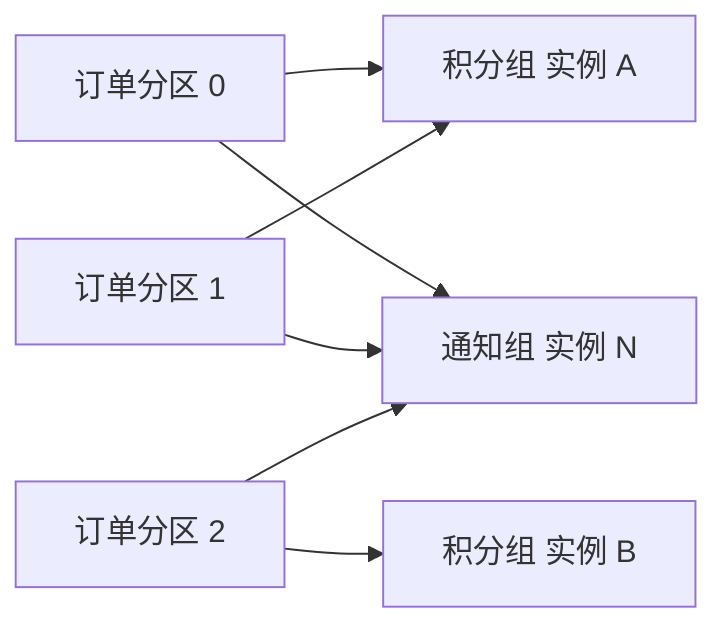

记录时间：2026-10-19 23:11:40 (Asia/Shanghai)

# 第06章｜Consumer Group：同组分工，不同组独立订阅

## 积分服务扩容，为什么不应该重复加积分

积分服务从一个实例扩到两个实例，希望二者分担订单流量；通知服务也要读取每一笔支付事件。这里有两种关系：积分实例之间是分工，积分与通知之间是独立订阅。

Consumer Group 表示一个逻辑订阅者。普通消费者通过相同的 `group.id` 加入同一组，再由组机制分配分区。不同服务若都需要完整事件流，应使用不同组名；同一服务的协作实例通常使用相同组名。[KafkaConsumer API：消费组与订阅](https://kafka.apache.org/41/javadoc/org/apache/kafka/clients/consumer/KafkaConsumer.html)

## 核心机制：分区分配属于“组内”关系

本章范围是普通 `subscribe()` 消费组。在稳定分配状态下，同一组中的一个分区分配给一个消费者；一个消费者可以负责多个分区。其他组可以独立拥有对这个分区的消费分配和进度。



图是三个分区的一种可能分配，不保证 A 永远拿到分区 0 和 1。成员加入、离开、失败或分区变化时，分配可能调整。Share Group 有不同的共享消费机制，不适用本章“一个分区由一个组内消费者负责”的规则；手动 `assign()` 也不执行这种自动组内分工。

## 打开三个终端观察

前置条件：`kafka-learn` 已运行，`learn-kafka-orders` 有三个分区。终端 A 运行积分实例 A：

```bash
docker exec -it kafka-learn /opt/kafka/bin/kafka-console-consumer.sh \
  --bootstrap-server localhost:9092 --topic learn-kafka-orders \
  --group learn-kafka-points --from-beginning \
  --consumer-property client.id=learn-points-a \
  --property print.partition=true
```

终端 B 使用相同命令，把 `client.id` 改为 `learn-points-b`，保留相同 `--group learn-kafka-points`。终端 C 独立读取通知事件：

```bash
docker exec -it kafka-learn /opt/kafka/bin/kafka-console-consumer.sh \
  --bootstrap-server localhost:9092 --topic learn-kafka-orders \
  --group learn-kafka-notify --from-beginning \
  --consumer-property client.id=learn-notify \
  --property print.partition=true
```

再用生产者发送多个不同订单 Key 的事件。预期积分 A、B 分担分区，通知实例独立读取；某个积分实例没有输出，也可能是其分区暂时没有新消息。不要用少量打印行直接判断分工是否成功，应该查询成员分配：

```bash
docker exec kafka-learn /opt/kafka/bin/kafka-consumer-groups.sh \
  --bootstrap-server localhost:9092 --describe \
  --group learn-kafka-points --members --verbose
```

预期显示两个成员及各自的 `ASSIGNMENT`，分区总数为 3。命令刚启动时组可能还在协调，可等稳定后再观察。这里是教学预期，未实际启动客户端验证。[官方运维：管理消费组](https://kafka.apache.org/41/operations/basic-kafka-operations/)

## 组名、客户端名和处理次数并不相同

`group.id` 决定加入哪个逻辑订阅者；`client.id` 主要帮助日志、请求和监控识别客户端，给 A、B 配不同 `client.id` 不会把它们拆成两个消费组。Java 配置、命令行参数与其他语言库的写法要区分。[Consumer 配置：group.id 与 client.id](https://kafka.apache.org/41/configuration/consumer-configs/)

同组分工也不等于业务只执行一次。实例可能更新了积分但未成功提交 Offset 就崩溃，接手分区的实例会再次读取。积分账本仍然需要用 `event_id` 等业务标识做幂等，不能把分区分配当成去重方案。

消费进度属于各个组。通知组落后不会阻止积分组继续读取，也不会让 Kafka 自动为通知无限延长保留期限。更换组名相当于创建另一份订阅进度，并不是给已有服务“换一个显示名称”。

三个分区时，给一个组开四个普通消费者，至少一个没有分区可分；扩容上限还会受下游数据库、外部接口与热点 Key 限制。只增加实例数量，不保证吞吐线性增长。

## 小练习

为积分、通知、报表各设计组名，再为积分的三个实例设计客户端名。判断：通知与积分误用同一组名时，会出现什么业务缺失？若再启动第四个积分实例，如何通过成员分配确认它是否拿到了分区？

用 `Ctrl+C` 结束三个客户端。此处保留消费组供后续进度章节观察，整套学习完成后再按目录统一清理。

---

[上一章](./2026-10-19-231140-05-Consumer与拉取模型.md) · [返回目录](./2026-10-19-231140-Kafka入门目录.md) · [下一章](./2026-10-19-231140-07-Offset与提交.md)
