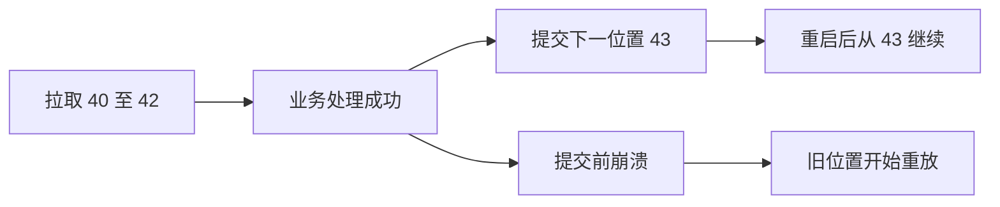

记录时间：2026-10-19 23:11:40 (Asia/Shanghai)

# 第07章｜Offset 与提交：记住下一条从哪里继续

## 从支付成功后的重启开始

订单 `order_id=order-1001` 的支付事件 `event_id=evt-paid-1001` 已经写入 Kafka。履约服务处理完成后突然重启，它怎样知道应该继续处理哪条消息？答案是消费组保存的 committed offset。本章以 Kafka 4.1.2、KRaft 为教学基线，基础 Topic `learn-kafka-orders` 有 3 个分区、每分区 1 个副本。

Offset 是分区内部的位置，不能单独拿数字定位消息，完整位置至少需要 Topic、Partition、Offset。同一个订单的 `event_id` 是业务身份，Offset 是存储位置；同一事件重复发送，可能获得不同位置，因此不能用 Offset 替代业务去重键。

## 三个进度不要混在一起

`poll()` 返回消息后，Consumer 的 position 会前进，它表示下次拉取的位置。业务处理可能尚未完成；committed offset 则是已经保存、恢复时使用的进度，通常由消费组 Coordinator 写入内部 Topic `__consumer_offsets`。

**提交的是下一条待处理的位置。** 假设分区 0 的 40、41、42 都已成功处理，就提交 43；提交 42 会让 42 再次被读取。若分区有空洞，应按实际读取顺序和 API 提供的后继位置推进，不能要求每个整数都对应一条业务消息。详见 [KafkaConsumer 的位移说明](https://kafka.apache.org/41/javadoc/org/apache/kafka/clients/consumer/KafkaConsumer.html)。



提交不会删除消息。分析组与履约组各自保存进度，履约组提交 43，并不会让分析组跳过这些支付事件。

## 先完成业务，再提交进度

下面是 Java 风格教学伪代码，省略客户端构造和异常处理。它刻意串行处理整个批次，仅在所有记录成功后使用 `nextOffsets()`，保留 API 提供的位移与 Leader Epoch 元数据。

```java
// 教学伪代码；配置 enable.auto.commit=false
while (running) {
    var records = consumer.poll(Duration.ofMillis(500));
    for (var record : records) {
        // event_id 唯一约束和业务更新应在数据库同一事务完成
        applyPaymentIdempotently(record.value());
    }
    if (!records.isEmpty()) {
        consumer.commitSync(records.nextOffsets());
    }
}
```

如果业务更新已提交、Kafka 位移尚未提交时崩溃，恢复后会重复投递；业务应按 `event_id` 幂等处理。反过来，先提交 43 再处理 42，崩溃后可能直接跳过尚未完成的业务，这个窗口更危险。`commitSync()` 成功仅代表保存消费进度，不会替你提交外部数据库事务。

## 并发处理要守住连续完成的前缀

线程池先完成 40 和 42、41 仍在执行时，最多只能提交 41。等 41 也成功，才推进到 43。直接提交“最大已完成 Offset 加一”会越过 41。这里的连续指已交付记录的顺序前缀，需兼容压缩、事务造成的位移空洞。

应由 Consumer 所在线程统一 `poll` 和提交；工作线程只回报结果。对处理中的分区使用 `pause()`、限制排队数量并继续及时 `poll()`，处理完后再 `resume()`。分区撤销时，还要处理任务取消和旧任务结果，避免分区交接后继续错误提交。Consumer 本身不能随意被多个线程并发调用。

## 观察与预期现象

当消费组 `learn-offset-lab` 已运行并保存过进度时，可执行只读查询：

```bash
docker exec kafka-learn /opt/kafka/bin/kafka-consumer-groups.sh \
  --bootstrap-server localhost:9092 \
  --describe --group learn-offset-lab
```

观察每个分区的 `CURRENT-OFFSET`、`LOG-END-OFFSET` 与 `LAG`。若示意值为 43、50，则位置差为 7；它不必等于 7 条待执行业务，因为日志可能有空洞或事务控制记录。没有创建该组时，工具提示组不存在或没有进度是正常现象，不是 Topic 丢失。

## 常见误区与练习

自动提交不知道线程池里的数据库任务是否结束；`auto.offset.reset=earliest` 也不会在每次启动时覆盖有效的已提交进度，它主要处理没有初始位移或位移已越界的情况。配置边界见 [Consumer 配置](https://kafka.apache.org/41/configuration/consumer-configs/)。

练习：分区 1 已提交 10，本次返回 10、11、12，业务完成 10 和 12 后崩溃。分别写出安全可提交位置、恢复后可能重复的记录，并解释为什么 `event_id` 去重仍然必要。再把 11 改成永久失败，思考应暂停、重试还是进入明确的失败处理流程。

更多提交元数据细节参见 [OffsetAndMetadata API](https://kafka.apache.org/41/javadoc/org/apache/kafka/clients/consumer/OffsetAndMetadata.html)。

---

[上一章](./2026-10-19-231140-06-ConsumerGroup.md) · [返回目录](./2026-10-19-231140-Kafka入门目录.md) · [下一章](./2026-10-19-231140-08-消费重平衡.md)
