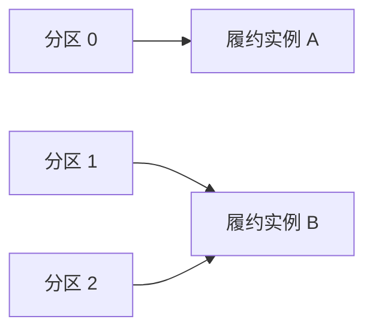

记录时间：2026-10-19 23:11:40 (Asia/Shanghai)

# 第08章｜消费重平衡：服务增减时怎样重新分工

## 为什么第二个消费者加入后会短暂停顿

履约服务独自消费订单支付事件时，需要承担全部分区。增加一个实例以后，Kafka 会重新分配分区，让同组成员分担任务；成员退出、失联或订阅分区变化也可能引发重新分配，这就是 Rebalance。本章采用 Kafka 4.1.2、KRaft 教学基线，讨论普通 Consumer Group。

普通消费组内，一个分区在同一时刻交给一个成员。`learn-kafka-orders` 有 3 个分区，所以增加到 4 个同组消费者时，至少一个成员没有分区。增加实例不会凭空提升一个热点分区的并行度，也不会让同组所有成员都收到同一条支付事件。

下面是两位消费者的一种分配示意，实际分配取决于协议、分配器及成员状态。



## 心跳正常，不代表业务仍在推进

心跳帮助 Coordinator 判断成员是否还活着；`max.poll.interval.ms` 限制两次 `poll()` 之间允许的最大间隔，防止一个仍发送心跳、业务却长期卡住的成员一直占着分区。两者检测的问题不同，不能用增加心跳频率解决慢数据库调用。

经典协议 `group.protocol=classic` 使用客户端的 `heartbeat.interval.ms` 和 `session.timeout.ms`。新协议 `group.protocol=consumer` 改由服务端 `group.consumer.heartbeat.interval.ms`、`group.consumer.session.timeout.ms` 控制对应时限，客户端旧选项不能照搬；`max.poll.interval.ms` 仍需关注。静态成员超过 poll 间隔时，分区也不一定立即转移，还会受会话超时约束。参见 [Consumer 配置](https://kafka.apache.org/41/configuration/consumer-configs/)。

假设一次取回 500 条支付事件，每条处理 1 秒，串行批次就需要约 500 秒。此时应结合 `max.poll.records`、实际耗时、背压和线程模型处理，单纯不断增大超时只会让故障恢复更慢。

## 用两个终端观察分区交接

前提是已按基础实验准备容器及 Topic；本章不启动或重建服务。在两个终端分别运行以下同一命令，显式选择经典协议以减少配置歧义：

```bash
docker exec -it kafka-learn /opt/kafka/bin/kafka-console-consumer.sh \
  --bootstrap-server localhost:9092 \
  --topic learn-kafka-orders --group learn-rebalance \
  --consumer-property group.protocol=classic \
  --consumer-property auto.offset.reset=earliest \
  --property print.partition=true --property print.offset=true
```

在第三个终端只读查看成员：

```bash
docker exec kafka-learn /opt/kafka/bin/kafka-consumer-groups.sh \
  --bootstrap-server localhost:9092 \
  --describe --group learn-rebalance --members --verbose
```

预期可以看到两个成员以及分区分配；只有一个终端时，它负责全部 3 个分区。按 `Ctrl+C` 退出其中一个消费者，等待组稳定后再次查询，剩余成员会接管分区。Topic 没有新消息时，终端安静不等于没有分配，应看成员和分区信息。本练习结束后退出两个消费者即可。

## 交接时，业务任务也需要交接

收到分区撤销回调时，应停止派发该分区的新任务，在允许的时间内收敛已完成结果，只提交安全的连续前缀。如果分区已经丢失，就不能继续假定自己拥有提交权；旧线程完成的支付任务仍可能产生外部副作用，所以仍需 `event_id` 幂等和必要的任务隔离。回调区别见 [ConsumerRebalanceListener API](https://kafka.apache.org/41/javadoc/org/apache/kafka/clients/consumer/ConsumerRebalanceListener.html)。

协作式分配可减少每次交接波及的分区，新 Consumer 协议也采用增量协调机制，但这不等于没有业务停顿或无需处理撤销。两种机制的配置入口不同，迁移时应按 [消费重平衡协议说明](https://kafka.apache.org/41/operations/consumer-rebalance-protocol/)核对，不能只修改分配器类名就假定已切换新协议。

## 边界与练习

普通 Consumer Group 与 Share Group 是不同消费模型，本章的独占分区、位移提交规则不应套用为 Share Group 的逐条确认机制。手动 `assign()` 也不等于动态订阅，它不会自动获得相同的组内分区接管行为。

练习：3 个分区依次增加到 1、2、4 个成员，记录每次分配。再推演某成员处理支付时超过 poll 间隔：为什么它可能仍有数据库写入成功，却在提交 Offset 时失败？把答案与上一章的重复消费窗口联系起来。

---

[上一章](./2026-10-19-231140-07-Offset与提交.md) · [返回目录](./2026-10-19-231140-Kafka入门目录.md) · [下一章](./2026-10-19-231140-09-副本与ISR.md)
