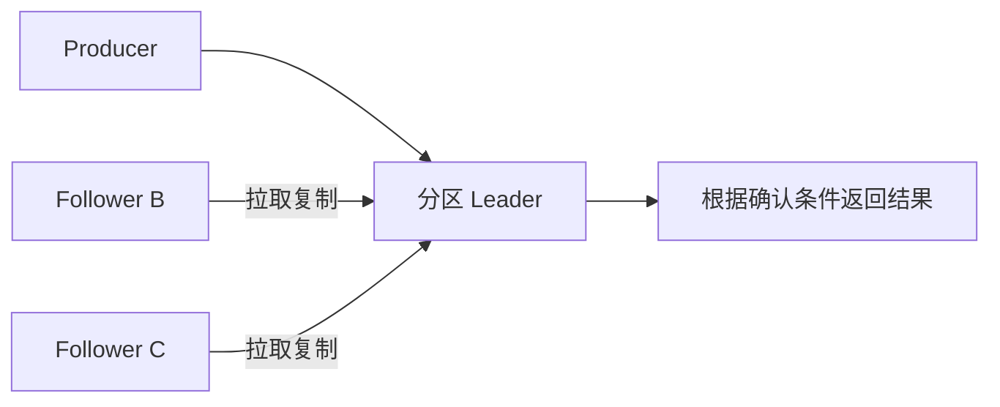

记录时间：2026-10-19 23:11:40 (Asia/Shanghai)

# 第09章｜副本与 ISR：写入确认为什么要看同步状态

## 订单事件不能只存在于一台机器

基础实验的 `learn-kafka-orders` 有 3 个分区、每分区 1 个副本。分区用于分工，副本用于保存同一分区的数据；“3 个分区”不代表每条支付消息有 3 份。单副本 Broker 故障时，没有另一个数据副本可以接管。本章以 Kafka 4.1.2、KRaft 为教学基线，先建立复制模型，再区分实验能力。

一个分区通常由 Leader 接收生产请求，Follower 从 Leader 拉取日志。ISR 是 In-Sync Replicas，即当前满足同步要求的副本集合，包含 Leader。它会随落后、失联和追赶恢复而变化，并不等于全部配置副本，更不是固定的多数派集合。复制机制见 [Kafka 复制设计](https://kafka.apache.org/41/design/design/)。



箭头表示请求方向，Follower 通过拉取获得数据，不表示消息经 Controller 转发。

## acks 与 min ISR 一起决定确认条件

下面只是独立三 Broker 集群的配置示意，不能直接用于单 Broker 基础环境：

```properties
# Topic 配置示意：必须有至少 3 个 Broker 承载 3 副本
replication.factor=3
min.insync.replicas=2
unclean.leader.election.enable=false

# Producer 配置示意
acks=all
enable.idempotence=true
```

`replication.factor` 在这里表达创建 Topic 时选择的复制因子，并不是通过 `kafka-configs.sh --alter` 动态修改副本数的属性。已有 Topic 更改副本分配需要另走重分配流程。

`acks=all` 关注当前 ISR，而不是无条件等待配置的全部副本；`min.insync.replicas=2` 则给可靠写入设置最低同步副本门槛。若 ISR 是 A、B、C，不能简单理解成收到任意两份确认就够；若 C 已离开 ISR，A、B 仍可满足最低要求；若只剩 A，可靠写入就不能继续正常成功确认。配置边界见 [Topic 配置](https://kafka.apache.org/41/configuration/topic-configs/)。

`acks=1` 只等待 Leader 级别的确认，不能把 `min.insync.replicas=2` 当作它的同等耐久保证。Producer 收到超时，也不一定意味着支付事件完全没写入，可能只是确认没有及时返回，所以重试仍需要幂等策略。

## 为什么不能把 ISR 直接解释成多数派

三个副本、两个同步副本的例子恰好像多数派，只是参数选择的结果。数据分区的 ISR 是动态同步集合；KRaft Controller 的多数派用于元数据共识，是另一套成员与规则。Controller 有三个，并不意味着每条支付事件会经过这三个 Controller 投票。

Kafka 4.1 新建集群还需留意 ELR，也就是 Eligible Leader Replicas。它记录某些虽然已经离开 ISR、但满足安全条件的候选副本，因此“非 ISR 副本绝不可能安全当选 Leader”在这一版本不是完整结论。是否启用、候选状态和恢复路径应按实际集群核对，不能只凭副本列表猜测。参见 [ELR 官方说明](https://kafka.apache.org/41/operations/eligible-leader-replicas/)。

关闭不干净选举有助于避免任意落后副本成为权威日志，但不能保证磁盘全部损坏时还可恢复。复制确认也不等于每条消息在所有机器上单独执行了 `fsync`。

## 先观察基础环境，再选择复制实验

基础环境可执行只读命令：

```bash
docker exec kafka-learn /opt/kafka/bin/kafka-topics.sh \
  --bootstrap-server localhost:9092 \
  --describe --topic learn-kafka-orders
```

预期有 3 个分区，每个分区的 Replicas、ISR 通常只有一个 Broker ID。具体 ID 以实际输出为准。这个输出证明了分区布局，不能验证三副本故障接管。记录观察时间、Leader、ISR 和发送端错误，才能把一次失败与当时的同步状态联系起来；仅凭恢复后的列表无法还原完整过程。

需要真实三副本观察时，可阅读项目 仓库内的 `demo-kafka-architecture/README.md`（KRaft 架构实验 README），按那个独立环境的说明操作；它使用自己的 Topic、容器和端口，不应混用本章单 Broker 命令。本章只提供阅读与观察步骤，不停启任何节点。

## 练习与判断

推演支付事件 `event_id=evt-paid-1001` 写入时，ISR 依次从 A、B、C 变成 A、B，再变成 A。分别判断 `acks=all`、最小 ISR 为 2 时的确认能力，说明为何副本列表仍有三个却可能写入失败。最后回答：增加分区数，能否修复单副本的耐久问题？

---

[上一章](./2026-10-19-231140-08-消费重平衡.md) · [返回目录](./2026-10-19-231140-Kafka入门目录.md) · [下一章](./2026-10-19-231140-10-KRaft架构.md)
