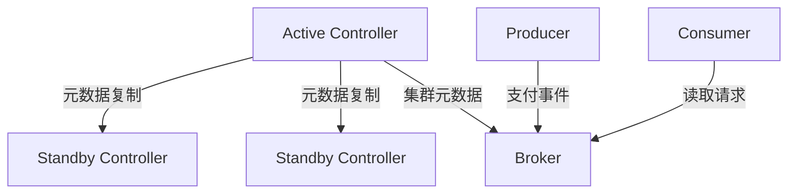

记录时间：2026-10-19 23:11:40 (Asia/Shanghai)

# 第10章｜KRaft 架构：元数据共识与业务消息各走哪条路

## Controller 不负责搬运每一条支付事件

生产者把 `event_id=evt-paid-1001`、`order_id=order-1001` 发到 Kafka 时，需要知道目标分区在哪个 Broker、谁是 Leader。这些集群结构信息属于元数据；订单消息的实际内容属于业务数据。KRaft 解决元数据的管理与共识问题，业务记录仍由 Broker 的分区日志存储和复制。

本系列使用 Kafka 4.1.2、KRaft 作为教学基线。Kafka 4.x 已移除 ZooKeeper 模式，因此这里不会先部署 ZooKeeper，也不能把较早教程中的配置直接照搬。两种架构的配置差异可参考 [KRaft 与 ZooKeeper 的区别](https://kafka.apache.org/41/getting-started/zk2kraft/)。



这是一张职责示意图，省略了发现、拉取和选举的具体协议步骤。业务消息不会先经 Controller，再转发到 Broker。

## 两种角色，两类持久化日志

Controller 维护 Broker 注册、Topic、分区、副本和 Leader 等集群元数据，多个 Controller 组成 metadata quorum，其中一个为 Active，其余处于待命状态。元数据变化进入 Raft 日志，并依靠多数派形成可靠的共同状态。

Broker 负责生产、读取及数据分区复制。订单消息保存在各分区的数据日志中；消费组进度通常由 Broker 上的 Group Coordinator 管理并写入 `__consumer_offsets`，不能理解成所有业务消费进度都直接存进 Controller 的元数据日志。

本地学习可以使用 `process.roles=broker,controller` 合并角色。生产规模通常考虑专用 Controller 与专用 Broker，隔离资源和故障影响。同进程合并不会让两个职责变成一件事，更不能把单节点实验视为具备高可用的部署。角色与部署建议见 [KRaft 运维说明](https://kafka.apache.org/41/operations/kraft/)。

## Controller 多数派与分区 ISR 有什么不同

三个投票 Controller 的 quorum 需要至少两个可用，通常能容忍一个 Controller 失效；五个需要三个，通常能容忍两个。这个多数派用于元数据共识，与订单分区的 ISR、复制因子、`min.insync.replicas` 分开计算。

假设 Controller 全部健康，但承载订单副本的 Broker 故障，支付事件仍可能无法写入。反过来，失去 Controller 多数派会影响需要共识的元数据操作和故障处理，但不能简化成“所有已建立的数据连接立即断开”。已有 Leader 的某些流量可能暂时继续，具体行为取决于后续故障、租约和集群状态，不应据此认定系统仍健康。

## 先用只读工具观察 quorum

基础实验已经运行后，可查询：

```bash
docker exec kafka-learn /opt/kafka/bin/kafka-metadata-quorum.sh \
  --bootstrap-server localhost:9092 describe --status
```

关注 `LeaderId`、`LeaderEpoch`、`HighWatermark`、`CurrentVoters` 等字段。单节点合并角色环境通常只有一个投票成员，没有 Controller 故障冗余。这里的 High Watermark 属于元数据日志，不能当作订单 Topic 已处理的 Offset；LeaderId 也不是订单分区 Leader 的统一答案。比较两次查询时，应同时记录采样时间和 Epoch，避免把角色切换前后的状态拼成同一个瞬间。

需要六节点真实拓扑时，可阅读 仓库内的 `demo-kafka-architecture/README.md`（KRaft 架构实验 README），按那个独立环境的运行说明操作。它采用三个专用 Controller 与三个专用 Broker，端口和容器名与本系列基础环境不同。本章不执行停机、格式化或集群成员变更。

## 配置为什么要与实际特性版本一起看

静态 quorum 常见 `controller.quorum.voters`，动态 quorum 使用 `controller.quorum.bootstrap.servers`。Kafka 4.1 支持动态 Controller 成员管理，但是否启用还需核对 `kraft.version` 和集群初始化方式，不能因为镜像版本是 4.1.2 就机械替换配置项。

`node.id` 标识节点，`controller.listener.names` 标识控制连接，客户端 `bootstrap.servers` 用于发现 Broker。把客户端接到 Controller 端口，不会获得普通生产消费能力。相关键可查 [Broker 配置](https://kafka.apache.org/41/configuration/broker-configs/)。已有数据目录也不能随意重新 format，否则可能破坏节点身份和日志状态。

## 练习

画出支付事件从 Producer 到分区 Leader、再到 Consumer 的路径，另画 Controller 的元数据路径。再分别推演“一个 Controller 失效”和“一个数据分区的全部副本失效”，说明为什么节点数量相同，影响却不同。

---

[上一章](./2026-10-19-231140-09-副本与ISR.md) · [返回目录](./2026-10-19-231140-Kafka入门目录.md) · [下一章](./2026-10-19-231140-11-日志存储与保留.md)
