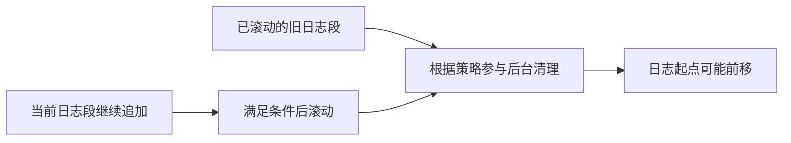

记录时间：2026-10-19 23:11:40 (Asia/Shanghai)

# 第11章｜日志存储与保留：消费以后，消息为什么还在

## 把 Kafka 日志和 Redis 过期时间分开理解

Redis 可以给某个 Key 设置过期时间；Kafka 的常规保留策略面对的是分区日志及日志段，不能把 `retention.ms` 理解成每条消息的精确 TTL。履约服务消费了支付事件，Kafka 通常仍保留记录，分析组或回放任务可以独立读取，直到清理策略真正移除相应数据。

本章以 Kafka 4.1.2、KRaft 为教学基线，基础 Topic 是 3 分区、单副本的 `learn-kafka-orders`。这里解释本地日志，不假定已启用远程分层存储。

## 分区日志由多个 Segment 组成

消息按分区顺序追加，当前写入的日志段称为 Active Segment。段达到大小或滚动条件后，会切换到新段。常见文件有保存记录的 `.log`、辅助定位的 `.index` 和时间索引 `.timeindex`。索引不是业务数据库的每行索引，也不代表每条消息都拥有一条独立索引项。文件机制可对照 [Kafka 4.1.2 的 LogSegment 源码](https://github.com/apache/kafka/blob/4.1.2/storage/src/main/java/org/apache/kafka/storage/internals/log/LogSegment.java)。



有序追加、批量处理和文件缓存有助于吞吐，但不能从“顺序写”推导出磁盘无限大、每条记录都立即完成独立 `fsync` 或任何故障下都不丢数据。

## delete 策略：按时间或大小清理旧段

下面是 Topic 层的配置示意，只用于理解参数，不直接修改已有数据：

```properties
cleanup.policy=delete
retention.ms=604800000
retention.bytes=1073741824
segment.bytes=104857600
segment.ms=3600000
```

这里的 7 天是示意保留时长；1 GiB 的大小限制按分区计算，3 个分区的 Topic 总量不是固定 1 GiB。时间和大小限制可以分别触发清理，不能理解成必须同时满足才删除。副本、索引和额外文件也会占空间，因此这些值不能直接当作精确磁盘配额。

清理按 Segment、由后台任务执行，并受时间戳、滚动和删除调度影响。刚超过 7 天的单条消息不一定立即消失；同一段内的记录也不会像 Redis Key 一样逐条精确过期。`segment.ms` 影响滚动粒度，也不是每隔一小时就删除整个 Topic。配置定义见 [Topic 配置](https://kafka.apache.org/41/configuration/topic-configs/)。

## compact 策略：保存 Key 的状态变化结果

如果把 `order_id` 作为 Key，值依次是“已创建”“已支付”“已完成”，压缩机制会在后台移除被同 Key 后续记录取代的旧值。它适合重建订单当前状态，但不适合要求永久保留每次支付事实的完整审计历史。

Compaction 不是发送时立即去重：消费者仍可能读到同 Key 多条记录，业务也不能用它替代 `event_id` 的唯一约束。以每条事件的 `event_id` 为 Key 时，每个 Key 都不同，自然不会压成每个订单一条。

压缩保留记录的原始 Offset，不重新编号，因此 10 后面可能直接读到 13。带 Key、真正空值的 tombstone 表达删除，字符串 `"null"` 不是空值；删除标记本身也有保留窗口，长期落后的恢复任务要考虑可能错过它。`compact,delete` 组合还会按删除策略清理旧段，不能承诺每个 Key 的最新值永久存在。机制边界见 [日志压缩设计](https://kafka.apache.org/41/design/design/)。

## 观察保留设置与预期结果

```bash
docker exec kafka-learn /opt/kafka/bin/kafka-configs.sh \
  --bootstrap-server localhost:9092 \
  --entity-type topics --entity-name learn-kafka-orders --describe
```

这个查询主要展示 Topic 配置覆盖；没有出现 `retention.ms` 不等于无限保留，可能正在继承 Broker 默认值。输出也不会列出“每条消息还有多少秒过期”。实际判断应结合有效配置、日志段与日志起点，不能凭观察几秒钟就认定清理失效。

消费组提交到 100 并不保护 0 至 99，组还停在 10 也不会阻止保留清理。若所需历史已经被删除，重置消费位移不能让它复活；恢复策略必须考虑 `auto.offset.reset`、业务补偿以及其他可靠数据源。

## 练习

分别为“支付事件审计流”和“订单当前状态流”选择 `delete` 或 `compact`，说明 Key 应如何选择。再推演某组暂停消费超过保留窗口，解释它重启后为什么可能无法从旧 Offset 接续，以及为什么减少 Lag 与增加保留空间需要一起考虑。

---

[上一章](./2026-10-19-231140-10-KRaft架构.md) · [返回目录](./2026-10-19-231140-Kafka入门目录.md) · [下一章](./2026-10-19-231140-12-消息交付语义.md)
