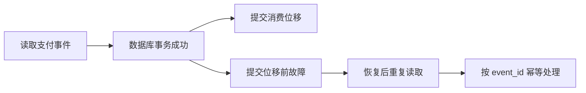

记录时间：2026-10-19 23:11:40 (Asia/Shanghai)

# 第12章｜消息交付语义：一次支付为什么可能被处理两次

## 先明确一次指的是哪一段

支付事件从 Producer 到 Kafka，再到履约服务和外部数据库，中间存在多个成功与失败边界。Kafka 中只写一份记录、Consumer 只读一次、订单只履约一次，是三个不同要求。讨论交付语义时，要说清保障覆盖哪一段。本章使用 Kafka 4.1.2、KRaft 教学基线。

| 语义 | 常见处理顺序 | 需要面对的结果 |
| --- | --- | --- |
| At-most-once | 先推进位移，再完成业务 | 故障窗口可能漏处理 |
| At-least-once | 先完成业务，再推进位移 | 故障窗口可能重复处理 |
| Exactly-once | 在明确边界内原子协调结果与进度 | 需要事务、隔离与恢复条件 |

这些名称不等于“网络永不失败”。以至少一次为例，还依赖重试恢复、数据仍在保留期内等前提，不是错误配置下也绝不丢失的承诺。

## 至少一次的重复窗口在哪里

履约服务读取 `event_id=evt-paid-1001`，把 `order_id=order-1001` 更新为已支付，并成功提交数据库事务；随后在提交 Kafka Offset 前崩溃。恢复后从旧位移再次读取，Kafka 无法仅凭上次读取知道数据库已经成功。反过来，提前提交位移又可能造成业务漏处理。



一个常见业务方案是在同一个数据库事务中，先插入唯一的 `event_id` 处理记录，再执行订单更新；唯一冲突时识别为已处理。去重记录和业务更新如果分成两个事务，仍可能出现只记去重却没更新订单的空档。发送邮件、调用支付接口等外部副作用，还需要对方的幂等键或额外协调。

## 幂等 Producer 解决发送重试，不替代业务幂等

```properties
# Producer 配置示意
acks=all
enable.idempotence=true
max.in.flight.requests.per.connection=5
```

幂等 Producer 通过协议身份、序列等机制避免其发送重试在日志里制造重复，要求相关配置兼容，例如 `acks=all`、允许重试、在途请求数不超过 5。应用主动调用两次 `send()` 发送相同 `event_id`，并不会自动按 JSON 字段去重；消费者更新数据库也不会因此只执行一次。参见 [Producer 配置](https://kafka.apache.org/41/configuration/producer-configs/)。

## Kafka 事务适合消费、转换、再写 Kafka

假设消费支付事件后生成履约事件，Kafka 事务可以把输出记录和输入组位移纳入同一事务。下面仅为教学伪代码，省略初始化配置和完整恢复逻辑：

```java
// transactional.id 应稳定标识逻辑生产者，不能被并发实例随意共用
// consumer: enable.auto.commit=false
producer.initTransactions();
var records = consumer.poll(Duration.ofMillis(500));
producer.beginTransaction();
for (var record : records) {
    producer.send(toFulfillmentRecord(record));
}
producer.sendOffsetsToTransaction(
    records.nextOffsets(), consumer.groupMetadata());
producer.commitTransaction();
```

只有整批成功转换才可使用这里的 `nextOffsets()`；不要另行调用普通提交抢先推进进度。异常时需要按错误类型终止、恢复位置或关闭客户端，不能仅 `abortTransaction()` 后继续使用已前进的 Consumer position，否则会跳过待重做记录。事务 API 和 fencing 要求见 [KafkaProducer 文档](https://kafka.apache.org/41/javadoc/org/apache/kafka/clients/producer/KafkaProducer.html)。

通用 Broker 的内部事务 Topic 默认复制因子为 3，但本系列 `apache/kafka:4.1.2` 镜像已把 `transaction.state.log.replication.factor` 和 `transaction.state.log.min.isr` 都设为 1，无需再为这两个参数修改镜像配置。参见[固定版本官方镜像配置](https://raw.githubusercontent.com/apache/kafka/4.1.2/docker/server.properties)。单副本只满足本地学习条件；本章伪代码仍不是完整事务程序，也不能证明生产可靠性。

## read_committed 与外部数据库的边界

下游要使用 `isolation.level=read_committed` 才会过滤已中止的事务记录。读取还受到 LSO 稳定边界约束：尚未完成的事务可能阻挡其后记录被返回，包括排在后面的非事务记录。因此看到日志末端有数据、消费者暂时读不到，并不必然是消费组故障。参见 [Consumer 隔离配置](https://kafka.apache.org/41/configuration/consumer-configs/)。

Kafka 事务不会自动把 MySQL 更新、HTTP 请求或邮件发送纳入原子提交。涉及外部系统时，应围绕具体边界设计业务幂等、Outbox、事务性存储位移或补偿流程，不能仅设置 `transactional.id` 就宣称整个业务 Exactly-once。

## 练习

为一次订单履约列出 Kafka 写入、数据库提交、位移提交三个成功点，分别在它们之间插入故障。标出重复或遗漏窗口，再说明 Producer 幂等、数据库 `event_id` 唯一约束、Kafka 事务各自能覆盖哪一段。

---

[上一章](./2026-10-19-231140-11-日志存储与保留.md) · [返回目录](./2026-10-19-231140-Kafka入门目录.md) · [下一章](./2026-10-19-231140-13-重试与死信.md)
