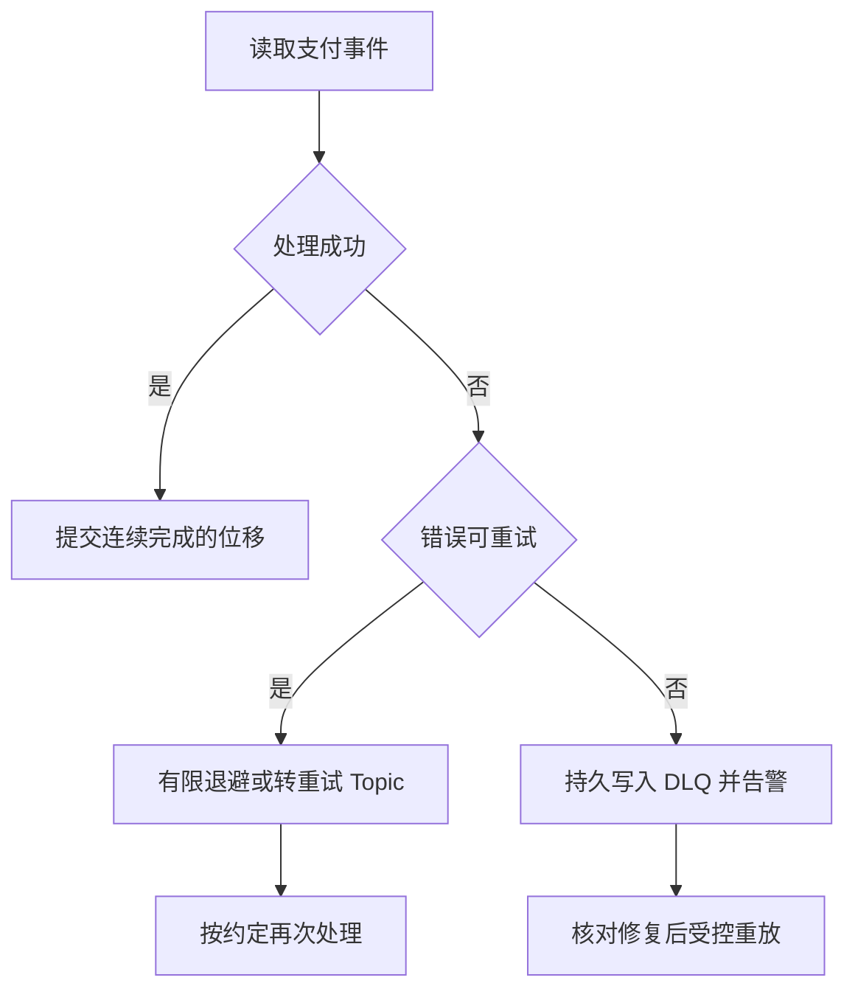

记录时间：2026-10-19 23:11:40 (Asia/Shanghai)

# 第13章｜重试与死信：失败的支付事件该去哪里

**本章问题：积分接口失败时，是一直重试、直接跳过，还是让后面的订单先走？**

订单 `order-1001` 的支付事件 `event-pay-1001` 已经进入 Kafka，积分服务却暂时连不上数据库。消息存在，不代表处理已经完成。消费者必须明确失败后的去向，否则可能让整条分区堵住，也可能在“跳过错误”时漏发积分。

本章沿用 Kafka 4.1.2、KRaft 教学基线，版本用于固定学习环境，并非最新版声明。下面的流程和数据是设计示例，未经实际运行。

## 先区分暂时失败和毒消息

数据库短暂超时、接口限流，可能在退避后恢复；缺少 `order_id`、金额类型不合法，则通常不会靠重复执行自行恢复。后一类无法被当前逻辑处理的记录常称为毒消息。先分类，再设次数、总时间和人工处理责任，比无限重试更有用。

一次失败也可能发生在业务已成功之后：积分已入库，响应在网络中丢失。重试仍应使用原始 `event_id`，由业务唯一约束保证同一事件只生效一次。重新生成事件 ID 会绕开去重。

## 三种路径对应不同代价

| 路径 | 适用情况 | 主要代价 |
| --- | --- | --- |
| 当前分区内有限重试 | 强调后续记录不能越过失败记录 | 同分区其他订单也会等待 |
| 转入重试 Topic | 允许其他记录继续，稍后再试 | 原业务顺序可能被打乱 |
| 转入死信 Topic，即 DLQ | 次数用尽或当前逻辑无法处理 | 需要告警、修复和重新投递流程 |

普通 Kafka Topic 没有“到指定时间才投递”的通用延迟队列语义。`next_attempt_at` 只是应用约定，需要调度器或框架判断时机。长时间阻塞处理线程还可能超过 `max.poll.interval.ms`，引发分区重新分配。需要暂停分区时，仍要正确维护 `poll()` 循环。[Consumer 配置说明](https://kafka.apache.org/41/configuration/consumer-configs/)



## 隔离时保留原始上下文

下面是发往 `learn-kafka-orders-dlq` 的教学消息。原始值若不能解析，应保存原始字节的安全编码及格式，不能只留下异常文字。

```json
{
  "event_id": "event-pay-1001",
  "order_id": "order-1001",
  "original_topic": "learn-kafka-orders",
  "original_partition": 0,
  "original_offset": 42,
  "attempt": 3,
  "error_code": "INVALID_AMOUNT",
  "original_value": "{\"event_id\":\"event-pay-1001\",\"order_id\":\"order-1001\",\"amount\":\"bad\"}"
}
```

还应按需保留 Key、Headers、首次失败时间和追踪标识；敏感字段控制权限与保留期，日志避免泄露原始支付信息。Kafka Connect 提供自身的错误报告和 DLQ 配置，但它们不是普通 Consumer 自动拥有的行为。[Connect 错误处理说明](https://kafka.apache.org/41/kafka-connect/user-guide/)

## 进入 DLQ 不等于业务成功

一种明确的策略是：关闭自动提交，确认隔离记录写入成功后，将原记录视为“已完成隔离”，再提交该分区连续完成范围的下一位移。监控中分别统计“业务完成”和“隔离待处理”，不能把 lag 清零当成积分已发完。

```text
教学伪代码：单分区按顺序处理
处理记录 42 失败且不可重试
等待 DLQ 写入获得确认
提交该分区位移 43
登记 event-pay-1001 等待人工修复
```

若 DLQ 已写入、位移尚未提交就崩溃，恢复后可能再次隔离同一条记录；隔离端和重放端都要去重。需要让 Kafka 输出与输入位移原子完成时，可以评估第15章的 Kafka 事务流程，但它仍不代表外部业务已执行成功。[Consumer 位移 API](https://kafka.apache.org/41/javadoc/org/apache/kafka/clients/consumer/KafkaConsumer.html)

## 顺序边界与练习

同一 `order_id` 的“已支付”转入重试 Topic 后，“已退款”可能先在主 Topic 被处理。即便两个 Topic 都使用相同 Key，也没有跨 Topic 的业务顺序保证。可选择按订单阻塞后续事件，或通过业务版本检查拒绝越序更新；选择需要符合状态机要求。

练习：在纸上列出“处理完成、DLQ 确认、位移提交”三处崩溃点，分别判断是否重试、是否重复、谁负责补偿。预期结论是：隔离保护消费进度，幂等保护业务结果，告警与重放负责把未完成事项真正处理完。

---

[上一章](./2026-10-19-231140-12-消息交付语义.md) · [返回目录](./2026-10-19-231140-Kafka入门目录.md) · [下一章](./2026-10-19-231140-14-消费积压与监控.md)
