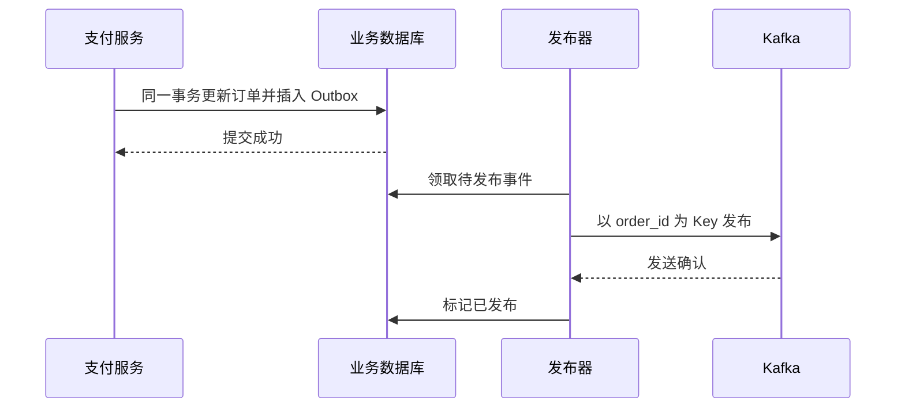

记录时间：2026-10-19 23:11:40 (Asia/Shanghai)

# 第15章｜事务与 Outbox：数据库成功后，事件怎样可靠发出

**本章问题：订单已支付，但进程在发 Kafka 前退出，积分服务怎样知道？**

先提交订单数据库，再发送 `event-pay-1001`，两步之间可能崩溃；先发送再提交数据库，又可能发布一个最终回滚的支付结果。普通 Kafka 事务不能把任意外部数据库更新、短信或支付调用自动包进同一次原子提交。先识别边界，再选择协调方式。

本章采用 Kafka 4.1.2、KRaft 教学基线。代码均为教学伪代码，未部署数据库、连接器或事务程序。

## Kafka 事务解决 Kafka 内部读写的一类问题

例如从 `learn-kafka-orders` 读取支付事件，转换后写入 `learn-kafka-points-requested`，同时推进输入位移。事务 Producer 可以把这些 Kafka 输出和消费位移一起提交；下游使用 `isolation.level=read_committed`，只读取成功提交的事务记录。[KafkaProducer 事务 API](https://kafka.apache.org/41/javadoc/org/apache/kafka/clients/producer/KafkaProducer.html)

```text
教学伪代码，省略异常分类和资源管理
Consumer: enable.auto.commit=false, isolation.level=read_committed
Producer: transactional.id=points-transform-instance-1
initTransactions()
records = poll()
beginTransaction()
将 records 转换并写入 learn-kafka-points-requested
sendOffsetsToTransaction(records.nextOffsets(), consumer.groupMetadata())
commitTransaction()
```

位移应表示下一条待处理位置。这个流程不能再混用自动提交或另一次普通位移提交；可中止错误需要正确回退，致命错误则关闭并恢复实例。并发运行的实例不能随意共用 `transactional.id`，否则会出现 fencing。

预期现象：事务中止时，`read_committed` 下游看不到其中的事务输出，输入进度也不会作为该事务成功提交。若程序另外调用了外部积分接口，接口副作用不会因 Kafka 中止而撤销。

需要区分通用 Broker 默认值和镜像预设：通用内部事务 Topic 默认复制因子为 3；本系列 `apache/kafka:4.1.2` 官方镜像已预设 `transaction.state.log.replication.factor=1`、`transaction.state.log.min.isr=1`，无需为单节点再修改这两项。见[固定版本镜像配置](https://raw.githubusercontent.com/apache/kafka/4.1.2/docker/server.properties)与[Broker 事务配置](https://kafka.apache.org/41/configuration/broker-configs/)。这只是学习预设，不代表单副本具备多节点耐久保证；执行事务仍需完整客户端配置与恢复逻辑。

## Outbox：在同一数据库里先记下发布义务

Outbox 是应用设计模式，不是 Kafka 自动创建的表。支付服务在同一个数据库事务内更新订单，并插入一条待发布事件；提交成功意味着业务状态和发布义务一起存在。

```sql
-- 教学伪 SQL：字段与语法应按实际数据库调整
BEGIN;
UPDATE orders SET status = 'PAID' WHERE order_id = 'order-1001';
INSERT INTO outbox(event_id, order_id, event_type, payload, status)
VALUES ('event-pay-1001', 'order-1001', 'order.paid',
        '{"event_id":"event-pay-1001","order_id":"order-1001"}', 'NEW');
COMMIT;
```

真实业务应校验订单状态迁移和影响行数，为 `event_id` 设置唯一约束；只有本次确实完成支付状态迁移时，才创建对应事件。这个数据库事务必须属于同一原子提交范围，不能把订单表和 Outbox 放在两个独立事务里。



## 发布成功后仍然可能重复

轮询发布器可能在 Kafka 已确认、数据库尚未标记时退出。下次仍会再次发送 `event-pay-1001`，因此消费者必须幂等；Outbox 解决的是双写遗漏窗口，不能把所有重复一并消除。多个发布器还要协调领取、失败重试和同订单的发布顺序。

另一条路径是通过 CDC 读取已提交的数据库变更。Debezium 提供 Outbox Event Router，可把 Outbox 行变换为 Kafka 记录；它需要相应数据库连接器、日志权限、字段映射与运维配置，并不会自动理解自定义表。[Debezium Outbox 官方说明](https://debezium.io/documentation/reference/stable/transformations/outbox-event-router.html)

## 练习：逐个画出故障窗口

分别在数据库提交前、提交后发送前、Kafka 确认后标记前中断流程。预期分别是“全部回滚”“发布器恢复后补发”“可能重复发布”。再回答：如果消费者已加积分但未提交位移，恢复后怎样避免再加一次？应把事件去重记录和积分更新放在自己的数据库事务中，不能只依赖 Producer 幂等配置。

可联系已有的[缓存一致性记录](../2026-10-19-175139-Redis入门详解/2026-10-19-175139-11-缓存一致性.md)：异步链路都应关注状态变化发生后，通知是否可恢复，以及重试是否会覆盖更新结果。

---

[上一章](./2026-10-19-231140-14-消费积压与监控.md) · [返回目录](./2026-10-19-231140-Kafka入门目录.md) · [下一章](./2026-10-19-231140-16-Connect与Streams.md)
