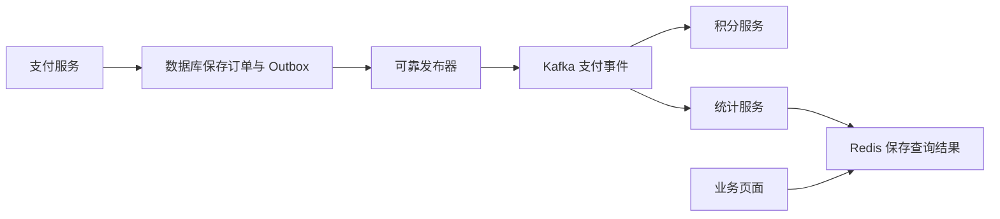

记录时间：2026-10-19 23:11:40 (Asia/Shanghai)

# 第17章｜Kafka 与 Redis 选型：按访问方式和恢复要求做决定

**本章问题：既然 Redis 也能发消息，支付事件还需要 Kafka 吗？**

先把需求说完整：是按订单 ID 查当前状态，是通知在线页面刷新，还是让积分、通知和分析服务分别处理支付历史？这些任务的读取方式、丢失代价和恢复要求不同，不能仅凭“谁更快”决定。

本系列 Kafka 4.1.2、KRaft 是固定教学基线，非最新版声明。本章为架构比较与命令示例，没有做吞吐测试，也没有启动 Redis 或 Kafka 来验证以下预期现象。

## 三种消息机制不能混为一谈

| 机制 | 主要使用方式 | 要先确认的边界 |
| --- | --- | --- |
| Redis Pub/Sub | 向当前在线订阅者推送通知 | 无离线历史补读，不能靠它恢复断线期间的支付事件 |
| Redis Streams | 在 Stream 中追加记录，读取或通过消费组协作 | 消费确认、待处理恢复、裁剪和持久化需设计 |
| Kafka | 按分区保存事件，多消费组各自推进位移 | 顺序范围、保留期、副本和消费幂等需设计 |

Redis Pub/Sub 提供 at-most-once 投递语义：订阅端断线或无法处理时，服务端不会自动为它补发遗漏消息。因此，它适合可容忍漏通知或能从业务状态重新查询恢复的场景，不能直接承担支付凭证的可靠传递。[Redis Pub/Sub 官方说明](https://redis.io/docs/latest/develop/pubsub/)

## Streams 有确认，但确认不是业务事务

Redis Streams 的消费组可跟踪交付后尚未确认的记录；`XACK` 将记录从该组的待处理列表移除，并不自动删除 Stream 内容，也不会替应用提交积分数据库事务。[XACK 官方说明](https://redis.io/docs/latest/commands/xack/)

```text
教学命令，在已准备好的独立 Redis 学习实例中执行
XADD learn:kafka-compare:paid * event_id event-pay-1001 order_id order-1001
XGROUP CREATE learn:kafka-compare:paid learn-points 0
XREADGROUP GROUP learn-points worker-1 COUNT 1 STREAMS learn:kafka-compare:paid >
XPENDING learn:kafka-compare:paid learn-points
XACK learn:kafka-compare:paid learn-points <替换为返回的消息ID>
```

预期现象：组创建成功后先读取现有记录，未确认前能在待处理列表中看到它；`XACK` 后该组不再把它视为待确认。若重复运行 `XGROUP CREATE`，可能返回组已存在；示例 ID 必须替换，不能原样复制占位符。

业务已完成但还没 `XACK` 就退出，恢复处理仍可能重复；先 `XACK` 再加积分则可能遗漏。需要设计幂等、领取超时记录和裁剪策略。Redis 崩溃后能恢复多少内容，还取决于 RDB、AOF、刷盘与复制等部署条件，不能由“用了 Streams”直接推导为零丢失。[Redis 持久化说明](https://redis.io/docs/latest/operate/oss_and_stack/management/persistence/)

## Kafka 的价值与代价放在同一张需求单上

当支付事件要长期保留、由多个系统独立重放，并持续进行流处理时，可以评估 Kafka。结合前面章节，可从 Topic、分区和消费组判断这种协作是否符合需要；同时也要计算 Broker、磁盘、副本、权限、事件契约、告警与恢复的维护成本。对已有 Redis、规模可控的简单任务，Streams 也可能满足要求，需要用实际容量和故障演练判断。

不要把 Kafka 当作按 ID 查询订单的数据库，也不要把它当作缓存命中时的一次 `GET`。读取日志来找某个订单，与索引查询当前订单状态不是同一种访问模式。Kafka 并不会自动拥有当前状态查询接口。



这个组合中，`event-pay-1001` 负责说明 `order-1001` 已支付；数据库保存正式业务状态；Redis 保存适合快速查询的派生结果。更新 Redis 的消费者仍要处理重复、乱序和重建，不能因为架构图上连通就认为结果必然一致。

## 选型练习与关联阅读

练习一：仅提醒在线后台刷新订单列表，断线后允许重新查数据库，Pub/Sub 是否足够？练习二：财务要重算过去一个月支付统计，历史保留、归档和事件完整性需要怎样保障？练习三：只存在一个低频后台任务，现有任务表是否已满足恢复要求？

预期答案应包含数据量、允许延迟、保留时间、顺序、幂等和维护人，而不是给出某个产品永远胜出的结论。可继续关联[Redis 的用途与架构位置](../2026-09-17-001524-Redis用途与架构位置.md)，并回看旧的[Kafka 实际开发用途记录](../2026-09-22-112448-Kafka实际开发用途.md)，将用途、机制与业务边界连起来。

---

[上一章](./2026-10-19-231140-16-Connect与Streams.md) · [返回目录](./2026-10-19-231140-Kafka入门目录.md)
