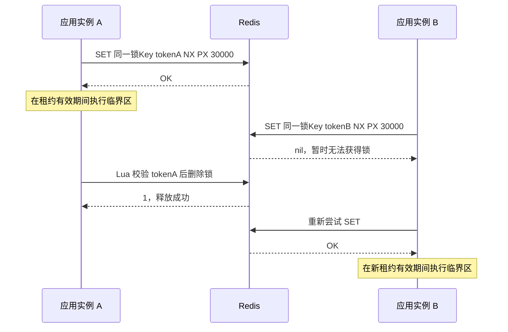

记录时间：2026-11-16 15:46:47 (Asia/Shanghai)

# Redis 分布式锁

Redis 分布式锁让不同进程、不同服务器上的应用通过同一个 Redis Key 竞争某项资源的处理资格。理解它的关键是：锁有有效期，获得锁不代表可以无限期执行。

本文从单 Redis 实例上的基础实现入手，配合仓库已有 Demo 观察互斥与锁过期现象。

## 一、为什么需要分布式锁

假设订单服务部署了三个实例，同时收到“处理订单 1001”的请求。如果每个实例只使用自己的进程内锁，三个实例仍可能同时处理同一订单，因为它们没有共享同一把锁。

让三个实例都竞争 `lock:order:1001`，就能在锁有效期间协调执行顺序。订单 1002 使用另一把锁，不必等待订单 1001。

| 机制 | 协调范围 | 主要用途 |
| --- | --- | --- |
| 进程内锁，例如 Python `threading.Lock` | 同一进程内使用该锁的线程 | 保护进程内共享状态 |
| Redis 分布式锁 | 访问同一锁 Key 的多个应用实例 | 协调缓存重建、任务执行等操作 |
| 数据库事务与行锁 | 对应数据库中的事务和数据 | 保证数据库内部的并发更新规则 |

适合先用来学习的场景是热点缓存重建：缓存失效时，让一个请求查询数据库并回填，其他请求稍后重试或读取允许使用的旧值。订单、支付等场景还要用数据库状态和幂等机制约束最终结果。

## 二、锁的核心组成

```redis
SET lock:order:1001 unique-token NX PX 30000
```

这条命令把“仅在 Key 不存在时写入”和“设置过期时间”放在一次原子操作中：

| 部分 | 含义 |
| --- | --- |
| `lock:order:1001` | 标识被保护的资源；所有竞争者必须使用同一个 Key |
| `unique-token` | 本次加锁的所有权标识；真实代码中每次新加锁都应生成新值 |
| `NX` | 只有 Key 不存在时才设置成功 |
| `PX 30000` | 从设置成功开始，锁最多存活 30000 毫秒 |

不带 `GET` 选项时，成功返回 `OK`，条件不满足返回空值，交互式 `redis-cli` 通常显示为 `(nil)`。`EX` 使用秒，`PX` 使用毫秒。[SET 官方文档](https://redis.io/docs/latest/commands/set/)

这里的 token 可以使用随机 UUID。它用来区分不同次加锁，不应只使用固定服务名或进程 ID；同一个进程的不同次加锁也需要区分。

锁更接近一份有期限的租约：Redis 中只有一个当前锁值，不代表旧持有者的业务代码已经停止。后文的 TTL 实验会展示这一点。

### 加锁到解锁的流程



这张图表示锁未提前过期时的正常流程。竞争失败后可以直接返回、稍后重试或在限定时间内等待；简单轮询不保证先来先得。

## 三、为什么加锁和解锁都要保证原子性

### 1. 不要拆开加锁与设置过期时间

下面是一个错误示例：

```redis
SETNX lock:order:1001 unique-token
EXPIRE lock:order:1001 30
```

如果第一条命令成功后进程崩溃，第二条命令没有执行，就可能留下没有 TTL 的锁。基础实现应使用一条 `SET ... NX EX/PX`。

### 2. 解锁前必须校验所有权

假设 A 的锁过期，B 获得了同一个 Key。A 恢复执行后若直接 `DEL`，会删除 B 的锁。

即使先 `GET` 再 `DEL`，两条独立命令之间也可能发生锁过期和重新加锁。需要让比较与删除在 Redis 内一次完成：

```lua
if redis.call('GET', KEYS[1]) == ARGV[1] then
    return redis.call('DEL', KEYS[1])
end
return 0
```

`KEYS[1]` 是锁 Key，`ARGV[1]` 是调用者保存的 token。返回 `1` 表示删除成功，返回 `0` 表示锁不存在或已属于其他持有者。[EVAL 参数说明](https://redis.io/docs/latest/commands/eval/)

Redis 执行该 Lua 脚本时，不会让其他客户端命令插入比较和删除之间。这种原子性限于 Redis 内部，不会把数据库、HTTP 请求等外部操作也变成一个事务。[Lua 脚本原子性说明](https://redis.io/docs/latest/develop/programmability/eval-intro/)

本文使用 Lua 方式，与仓库 `redis:7-alpine` 的配置保持一致。官方文档也介绍了 Redis 8.4 起的 `DELEX ... IFEQ` 条件删除方式；在旧版本上应继续使用 Lua。[官方分布式锁说明](https://redis.io/docs/latest/develop/clients/patterns/distributed-locks/)

## 四、动手观察加锁与安全解锁

### 运行前置条件

- 本机已有可访问的 Redis；下面命令默认使用 `127.0.0.1:6379`、数据库 `0`。
- 已安装 `redis-cli`，使用两个终端模拟两个客户端。
- 如需启动仓库自带的 Redis，需要 Docker 与 Docker Compose。
- 后面的 Python Demo 还需要项目使用的 `uv` 和 Python 环境。

以下 Shell 命令均在项目根目录执行。已有 Redis 时可跳过启动步骤：

```bash
docker compose -f demo-install-redis/docker-compose.yml up -d redis
redis-cli -h 127.0.0.1 -p 6379 PING
```

预期返回 `PONG`。没有本机 `redis-cli` 时，可以用下面的命令进入容器内的交互客户端：

```bash
docker compose -f demo-install-redis/docker-compose.yml exec redis redis-cli
```

有本机客户端时，在两个终端分别进入：

```bash
redis-cli -h 127.0.0.1 -p 6379
```

下面使用独立的学习 Key。`client-A-demo`、`client-B-demo` 是手工实验标识，真实应用应为每次新加锁生成唯一 token。

### 步骤 1：终端 A 加锁

```redis
SET learn:distributed-lock:intro:order:1001 client-A-demo NX PX 30000
PTTL learn:distributed-lock:intro:order:1001
```

预期先返回 `OK`，再返回不超过 `30000` 的非负毫秒数。如果操作时已经过期，`PTTL` 返回 `-2`；`-1` 表示 Key 存在但没有设置过期时间。[PTTL 官方文档](https://redis.io/docs/latest/commands/pttl/)

### 步骤 2：在 30 秒内让终端 B 竞争

```redis
SET learn:distributed-lock:intro:order:1001 client-B-demo NX PX 30000
GET learn:distributed-lock:intro:order:1001
```

预期加锁返回 `(nil)`，锁值仍是 `client-A-demo`。如果 B 得到 `OK`，说明 A 的锁已经过期或被释放，可以等待本轮结束后重新实验。

### 步骤 3：终端 B 尝试释放 A 的锁

```redis
EVAL "if redis.call('GET', KEYS[1]) == ARGV[1] then return redis.call('DEL', KEYS[1]) end return 0" 1 learn:distributed-lock:intro:order:1001 client-B-demo
```

在 A 的锁仍有效时，预期返回 `0`，锁仍然属于 A。

### 步骤 4：终端 A 安全释放

```redis
EVAL "if redis.call('GET', KEYS[1]) == ARGV[1] then return redis.call('DEL', KEYS[1]) end return 0" 1 learn:distributed-lock:intro:order:1001 client-A-demo
```

锁仍属于 A 时返回 `1`。此时 B 再执行步骤 2 的加锁命令，就应得到 `OK`。如果 A 返回 `0`，先检查是否已经超过 30 秒。

### 清理方式

确认两个终端的实验都已结束后，删除本次手工实验的 Key：

```redis
DEL learn:distributed-lock:intro:order:1001
```

这里的直接删除只用于结束后的学习数据清理，业务运行中的解锁仍需校验 token。不执行清理时，实验锁也会自行过期。

如果 Redis 是为本次学习单独启动的，可在项目根目录停止服务；数据卷会保留：

```bash
docker compose -f demo-install-redis/docker-compose.yml stop redis
```

## 五、用已有 Demo 观察并发与过期风险

本目录复用 [demo-redis-lock](../../demo-redis-lock/README.md)，其代码采用 `SET NX EX`，TTL 单位是秒，默认不自动续期。

### 实验 1：TTL 覆盖业务执行时间

在项目根目录运行：

```bash
uv run python demo-redis-lock/distributed_lock.py \
  --workers 3 \
  --hold-seconds 0.2 \
  --wait-timeout 5 \
  --lock-ttl 5
```

本地正常调度下，预期看到：

```text
成功获取锁：3
等待超时：0
安全释放锁：3
释放失败：0
临界区重叠次数：0
```

进程获得锁的先后顺序不固定。这里的 `--wait-timeout` 是等待获得锁的时间，`--lock-ttl` 是每次成功加锁后的有效期，两者互不替代。

### 实验 2：业务执行时间超过 TTL

```bash
uv run python demo-redis-lock/distributed_lock.py \
  --workers 3 \
  --hold-seconds 4 \
  --wait-timeout 12 \
  --lock-ttl 1
```

可能观察到“当前并发数”大于 `1`、“临界区重叠次数”大于 `0`，以及旧进程释放失败。原因是：A 仍在执行，锁却已经过期，B 因而重新获得锁并进入临界区。

这个实验同时说明两件事：唯一 token 能阻止旧进程误删新锁；它无法阻止旧进程继续执行已经开始的业务。

Demo 每次运行会生成独立的 Key，结果数据约 5 分钟后过期。立即清理的方法和参数说明见 [Demo README](../../demo-redis-lock/README.md)。

## 六、TTL 与续期

TTL 太短容易在业务完成前失效；太长则会增加持有者崩溃后的等待时间。应结合业务耗时、外部请求超时和调度延迟设置，并把锁获取等待、Redis 网络请求、业务执行的超时分别管理。

执行时间不确定的任务可以在锁有效期间定期续期，但续期也必须先验证 token：

```lua
if redis.call('GET', KEYS[1]) == ARGV[1] then
    return redis.call('PEXPIRE', KEYS[1], tonumber(ARGV[2]))
end
return 0
```

`ARGV[2]` 应是经过应用校验的正整数毫秒数。`PEXPIRE` 将剩余有效期重新设置为指定时长，从续期执行时开始计算。[PEXPIRE 官方文档](https://redis.io/docs/latest/commands/pexpire/)

实际实现还需要处理：

- 在到期前预留续期时间，并限制任务最长执行时间。
- 续期返回 `0`，或网络超时导致无法确认租约时，停止发起依赖该锁的新操作，并取消能够取消的工作。
- 结束业务后停止续期，在 `finally` 等清理路径中尝试安全解锁。
- 用有限等待和带随机抖动的退避重试减少竞争，避免无间隔循环请求 Redis。

进程长时间暂停或网络中断时，续期任务也可能无法运行。因此自动续期不能替代业务层对过期持有者的约束。

## 七、故障边界与 fencing token

### 1. 加锁请求超时，结果可能未知

Redis 可能已经写入锁，但响应没有返回。客户端不能把网络超时当成已获得锁，也不能继续执行临界区。基础实现可以放弃本轮执行，让已写入的锁到期；如需主动清理，只能按本轮 token 安全释放。

即使收到了成功响应，也要考虑请求往返已经消耗的租约时间。对于执行前已无足够有效期的请求，应放弃或通过正确的续期协议重新确认资格。

### 2. 主从切换可能丢失锁记录

Redis 默认使用异步复制。若主节点在锁写入尚未复制时故障，新主节点可能没有该 Key，另一客户端就能再次加锁。Sentinel 或 Redis Cluster 的故障转移能力本身不能消除这个窗口。[Redis 复制说明](https://redis.io/docs/latest/operate/oss_and_stack/management/replication/)

### 3. 所有权 token 与 fencing token 的作用不同

随机所有权 token 用于确认“这还是不是我那一次加的锁”。fencing token 则是随每次有效租约单调递增的序号，例如 `41`、`42`。

应用在写入受保护资源时携带 fencing token。资源端必须把版本检查和写入原子地结合，并持久保存已经接受的序号；接受 `42` 后，拒绝旧持有者携带 `41` 的写入。这样，即使旧进程恢复执行，下游也能识别它已经失去资格。[官方关于 fencing token 的说明](https://redis.io/docs/latest/develop/clients/patterns/distributed-locks/#disclaimer-about-consistency)

生成序号的机制还必须在故障和恢复后保持所需的单调性，并与租约授予正确结合。不能仅因为使用了普通 Redis `INCR`，就假设数据丢失、回滚或切换后仍满足这些条件；资源端如果不校验，序号也无法发挥作用。

### 4. Redlock 是什么

Redlock 在多个相互独立的 Redis 节点上尝试加锁，同时检查多数派成功与剩余有效期。它与一主多从的故障切换机制不同，也仍然依赖时间与故障模型的假设。学习基础锁之后，再结合业务正确性要求研究其适用范围。[Redlock 算法说明](https://redis.io/docs/latest/develop/clients/patterns/distributed-locks/#the-redlock-algorithm)

## 八、分布式锁、幂等与事务的关系

| 机制 | 主要回答的问题 | 例子 |
| --- | --- | --- |
| 分布式锁 | 当前由谁执行某项工作？ | 尽量让一个实例重建缓存 |
| 幂等设计 | 同一业务请求重复到达，是否重复产生副作用？ | 支付请求号唯一约束与结果记录 |
| 数据库事务与条件更新 | 数据变更能否满足原子性和并发约束？ | 按订单当前状态执行条件更新 |
| fencing token | 下游能否拒绝旧租约的写入？ | 资源端拒绝较旧序号的更新 |

例如，订单处理完成后释放了锁，重复请求仍能再次获得锁。因此“先加锁，再处理”不能单独保证同一订单只处理一次，还需要检查持久化业务状态，并让状态变更满足数据库约束。

## 九、常见问题

| 问题或现象 | 检查方向 |
| --- | --- |
| Redis 无法连接 | 确认服务、地址和端口；容器内应用的 `localhost` 指向该容器自身 |
| 一直无法获得锁 | 查看 `GET` 与 `PTTL`；区分其他持有者、等待超时和网络异常 |
| `PTTL` 返回 `-1` | 锁没有过期时间，检查是否拆分了加锁和设置 TTL |
| 解锁返回 `0` | 锁可能已过期、已被释放，或 token 不匹配；不要改成无条件删除 |
| 需要同线程再次加锁 | 基础 `SET NX` 锁不支持重入；同一持有者再次调用也会竞争失败 |
| 高并发下频繁超时 | 检查锁粒度、临界区耗时、重试策略和数据库访问，避免所有资源共用一把锁 |
| 明明设置了 TTL，仍出现重复执行 | 检查业务是否超过租约、进程是否暂停、Redis 是否切换或丢失数据 |

## 十、关联已有学习记录

- [Redis 核心原理与实践](../2026-09-18-145019-Redis核心原理与实践.md)：已有分布式锁、幂等和缓存重建概述。
- [Redis 生产作用与关键问题](../2026-09-18-145048-Redis生产作用与关键问题.md)：已有跨实例协调与业务正确性讨论。
- [缓存击穿](../2026-10-19-175139-Redis入门详解/2026-10-19-175139-16-缓存击穿.md)：结合热点缓存重建理解锁的使用位置。
- [分布式锁 Demo](../../demo-distributed-lock/README.md)：保留的另一份多进程实践示例。

本记录补充展开分布式锁主题，已有学习记录与示例保持原样。
