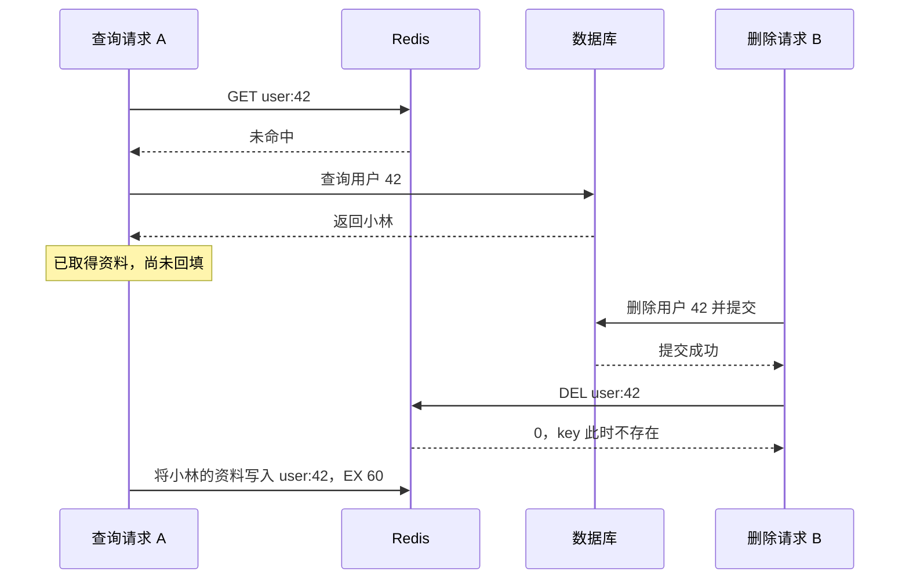

记录时间：2026-11-18 14:47:35 (Asia/Shanghai)

# 怎么保证数据库和 Redis 缓存的数据一致性？

把数据库作为权威数据源，Redis 保存可重建的副本。用户资料展示通常能接受短暂的旧值，可以采用旁路缓存（Cache-Aside），在数据库事务提交后删除缓存。账户注销后的访问权限则需要立即生效，这类请求应从能看到最新提交的数据源校验。

## 日常读写怎么做

- **读请求**先用 `GET` 查 Redis。命中就返回，未命中就查数据库，并在同一条 `SET ... EX ...` 命令中写入结果和过期时间。回源读取主库可以避开从库复制延迟造成的旧数据回填。[Redis SET 文档](https://redis.io/docs/latest/commands/set/)
- **写请求**先修改数据库并等待 `COMMIT` 成功，再对受影响的 key 执行 `DEL`。若先删缓存，另一个请求可能在事务提交前查到旧资料并写回。若每次修改都直接更新缓存，两次写库按顺序提交，发往 Redis 的两次 `SET` 却可能反序到达，让较早的值覆盖较新的值。[Cache-Aside 模式](https://learn.microsoft.com/en-us/azure/architecture/patterns/cache-aside)

## 删除成功后，旧用户为什么还能被查到？

仓库中的用户服务有两条可以放在一起看的路径。`GET /users/cache/{user_id}` 未命中时先查 PostgreSQL，再回填 Redis。`DELETE /users/{user_id}` 先提交数据库删除，再让 Redis 中的用户缓存失效。[用户查询与回填](../demo-user-service/backend/app/main.py#L191) · [用户删除](../demo-user-service/backend/app/main.py#L290)



用独立的 SQLite 数据库和 Redis 实例按图中的顺序执行，得到下列结果。数据库和缓存命令都执行成功，后来的读请求仍能从缓存里查到已删除的用户。`DEL` 返回 0 只说明执行删除的那个时刻 key 不存在。[Redis DEL 文档](https://redis.io/docs/latest/commands/del/)

```text
删除事务提交后 DEL 的返回值 = 0
慢请求回填后 Redis GET = {"id":42,"name":"小林"}
同一时刻数据库查询行数 = 0
```

## 按旧值产生的原因处理

**数据库已提交，删除命令漏了。** 如果进程在提交后、调用 Redis 前退出，异常处理代码也来不及运行。可以将业务修改和一条“使用户 42 的缓存失效”的待办记录放进同一个数据库事务，这叫事务性发件箱（Transactional Outbox）。后台任务取到已提交的待办后执行 `DEL`，收到成功响应才标记完成，超时就重试。重复删除偶尔会清掉刚重建的新缓存，让下一次请求多查一次库。已有变更日志订阅（CDC）时，也可以从已提交的变更驱动失效。[AWS 事务性发件箱](https://docs.aws.amazon.com/prescriptive-guidance/latest/cloud-design-patterns/transactional-outbox.html)

**缓存已删除，旧的查询结果又被写回。** 这时即便失效事件已成功处理，慢请求仍能造成图中的结果。普通展示可以给每次回填设置固定 TTL，让这份旧值自行过期。图中的 60 秒从 A 回填时算起。延时再删一次能清理第二次删除之前到达的旧值，更晚的回填仍可能发生。若需要拦住这种回填，可以在缓存未命中时先领取与 key 绑定的回填令牌，再查主库。写方在 Redis 中原子地删值并撤销令牌，读方回填时原子地校验令牌并写值。令牌已失效就放弃回填。[USENIX 论文《Scaling Memcache at Facebook》§3.2.1](https://www.usenix.org/conference/nsdi13/technical-sessions/presentation/nishtala)

## 哪些请求必须读到新值？

| 业务要求 | 读取或决策方式 |
| --- | --- |
| 其他人浏览用户资料，允许短暂看到旧昵称 | 提交后删缓存，可靠重试，并给回填值设置 TTL。写入停止、旧请求结束后，缓存失效，后续读取从主库重新加载，达到最终一致。 |
| 用户改完昵称，自己马上刷新就要看到修改 | 写接口返回已提交的资料版本。后续请求携带最低可接受版本，缓存版本足够新就返回，否则从能看到这次提交的主库读取。 |
| 账号已注销，随后发起的敏感操作必须被拒绝 | 在处理敏感操作时从权威数据源校验状态。如果校验结果决定是否写入，还要让数据库在同一事务中通过条件更新或行锁协调校验与写入。 |

以 PostgreSQL 为例，在主库上使用 `READ COMMITTED` 时，提交完成后才开始的查询能看到这次提交或之后的状态。复用一个更早开始的 `REPEATABLE READ` 快照，查询结果仍可能停留在旧状态。[PostgreSQL 事务隔离](https://www.postgresql.org/docs/current/transaction-iso.html)

同一主题的已有记录以商品改价为例，可以对照用户删除的时序阅读。[缓存一致性学习记录](./2026-10-19-175139-Redis入门详解/2026-10-19-175139-11-缓存一致性.md) · [Cache-Aside 旁路缓存](./2026-10-19-175139-Redis入门详解/2026-10-19-175139-10-Cache-Aside旁路缓存.md)
